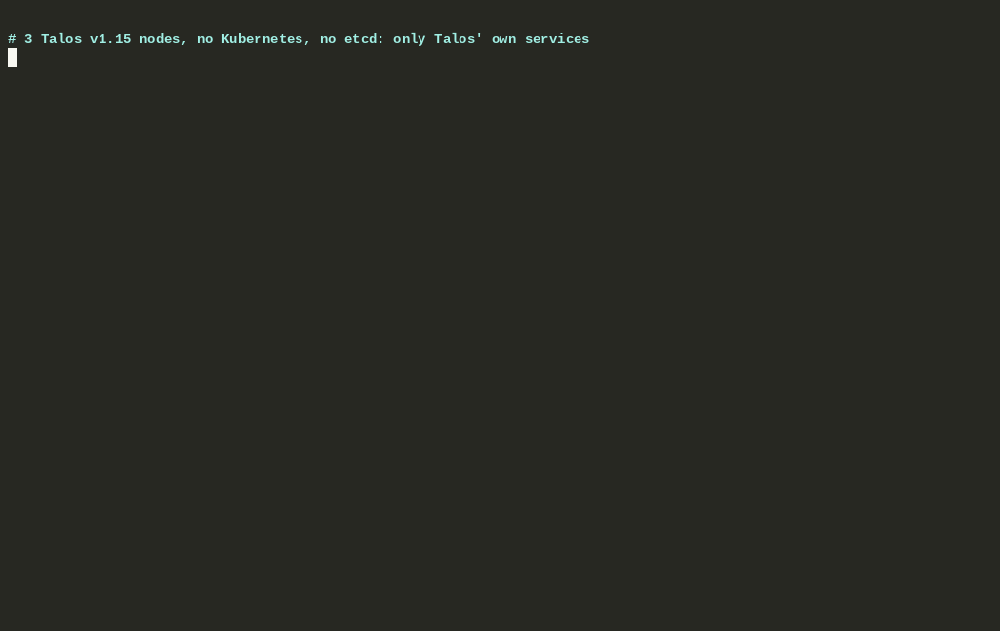

# cephadm-talos

> [!WARNING]
> **Not ready for your production data, nowhere near.** This is a proof of concept. Read [SHORTCOMINGS.md](SHORTCOMINGS.md) before you put anything on it that you care about.
>
> It also depends on Talos features that are still missing. The feature requests and their status are in [upstream/talos/README.md](upstream/talos/README.md); the plan towards production is in [ROADMAP.md](ROADMAP.md).



Also available as [SVG](demo/demo.svg) and as an [asciinema recording](demo/demo.cast) (`asciinema play demo/demo.cast`).

## Why

My main goal was to find out whether [Talos Linux](https://www.talos.dev) can replace the operating system of my dedicated Ceph cluster. That means Talos as an immutable, API-managed OS that runs Ceph directly, without Kubernetes and without Rook.

cephadm-talos is a cephadm clone for Talos: a Go CLI that bootstraps the cluster, an agent on every node, and a mgr module behind `ceph orch`. After bootstrap the CLI hands the cluster over, and from then on it is changed through `ceph orch`, as with cephadm: daemons, OSDs, hosts, maintenance, rolling upgrades, RGW and its keepalived ingress.

There is no SSH, no systemd and no python on the hosts. Each Ceph daemon is a Talos `ContainerConfig` machine config document, applied through the Talos API (the machinery Go client, no `talosctl`) in no-reboot mode, and run by Talos itself in the containerd namespace `taloscontainers`. How the pieces talk to each other, and what each of them may do, is in [docs/architecture.md](docs/architecture.md).

The demo above runs on 3 Talos v1.15.0-alpha.1 nodes created with `--skip-etcd-k8s`, with the CLI of the proof of concept. There is no Kubernetes and no etcd: the machine config's `cluster:` section is empty. The pauses in the recording, mostly image pulls, are shortened.

## Requirements

- Talos nodes, amd64 with x86-64-v3 CPUs and lowercase hostnames, built from the combined branch of our open Talos PRs until they are released, and the latest Ceph release (today v21.2.0); see [docs/support.md](docs/support.md). Workload isolation must be off until Talos PR #14603 is released.
- The agent image in a registry the nodes can pull from (`hack/agent-image.sh` builds and pushes it).
- A talosconfig for the nodes (`--talosconfig`, `$TALOSCONFIG` or `~/.talos/config`). `talosctl` itself is not needed.
- Free raw disks on the nodes for OSDs. These must not be claimed by any Talos volume.
- No Ceph tooling on your workstation. `ceph` commands run through Talos exec in a Ceph container on the nodes (`cephadm-talos shell`), the admin keyring passed over stdin.

## How cephadm concepts map to Talos

| cephadm | cephadm-talos |
|---|---|
| SSH + `cephadm` python binary on the host | machine config documents applied through the Talos API: by the CLI until the handoff, then only by each node's agent on its own node |
| the cephadm mgr module (`ceph orch`) | a mgr module installed as `cephadm`: it accepts `ceph orch` commands into a ledger in config-key; the leader, in the active mgr's agent, carries them out by granting changes to the agents |
| cephadm's host agent | `cephadm-talos agent`, one container per node with access to its own node's Talos API only; it applies what the leader grants, after a confirmation from the active mgr and checks against the operator's approval |
| systemd unit `ceph-<fsid>@<daemon>` + `unit.run` | `ContainerConfig` `ceph-<fsid8>-<type>-<id>`, with a restart backoff and a stop timeout |
| `/var/lib/ceph/<fsid>` | `UserVolumeConfig` `ceph` (`volumeType: directory`, `/var/mnt/ceph`), mounted at `/var/lib/ceph` |
| `/etc/ceph/ceph.conf` written over SSH | `EtcFileConfig` `ceph/ceph.conf` |
| keyring files written over SSH | base64 env var in the daemon's document; mon auth is authoritative |
| cluster state in the mon config-key store | the same: the cluster state is in config-key, published by the leader; the workstation keeps `ceph.conf`, the admin keyring and the nodes' contacts |
| `cephadm shell` | `cephadm-talos shell`: exec into a running mgr or mon container |
| `cephadm ceph-volume` | one-shot job containers (`restart: never`) with result files: OSD preparation, zap |
| `ceph orch daemon add/rm`, `osd rm`, `host add/rm/maintenance`, `hardware powercycle`, `upgrade` | the same `ceph orch` commands, a subset of their options ([capability matrix](docs/capabilities.md)) |
| `ceph orch apply ingress` (haproxy + keepalived) | `ceph orch apply -i` with a keepalived-only ingress (no haproxy) |
| `cephadm rm-cluster` | `cephadm-talos rm-cluster` |

The operator signs which images the cluster may run and which disks may be prepared as OSDs (`cephadm-talos approve`), with a key only the workstation holds; the agents refuse other images and preparations, also from a compromised leader (a zap needs either an approval or the cluster's BlueStore label on the disk). This does not hold on a compromised leader's own node, where its agent is root-equivalent, nor, if that node is a Talos control plane, on the nodes that trust the same Talos CA, for which such an agent can sign itself Talos credentials ([docs/architecture.md](docs/architecture.md), "Security implications").

## Usage

```sh
go build -o cephadm-talos ./cmd/cephadm-talos

# the node agent image (FROM scratch): needs docker and crane, and a registry the
# nodes can pull from; for the QEMU cluster a local one on the bridge:
#   docker run -d --name registry -p 5000:5000 registry:2 && hack/test-registry.sh
# hack/agent-image.sh [push-ref [pull-ref]] pushes it and prints the pinned reference
AGENT=$(hack/agent-image.sh)

# create the cluster (1 mon + 1 mgr, the agent, the mgr module), then hand it
# to the agents and the leader
./cephadm-talos --talosconfig ./.talosconfig bootstrap --mon-node 10.5.0.3 --image quay.io/ceph/ceph:v21.2.0 --agent-image "$AGENT"
./cephadm-talos handoff

# more nodes: the CLI enrolls each (its agent, no cluster document), then `ceph orch host add`
./cephadm-talos host add 10.5.0.2
./cephadm-talos host add 10.5.0.4

# from here on, ceph orch
./cephadm-talos shell -- ceph orch daemon add mon cephadm-talos-controlplane-1
./cephadm-talos shell -- ceph orch daemon add mon cephadm-talos-controlplane-3
./cephadm-talos shell -- ceph orch daemon add mgr cephadm-talos-controlplane-3

# OSDs: the operator approves each disk first
./cephadm-talos approve --prepare cephadm-talos-controlplane-1:/dev/sda --prepare cephadm-talos-controlplane-2:/dev/sda
./cephadm-talos shell -- ceph orch daemon add osd cephadm-talos-controlplane-1:/dev/sda
./cephadm-talos shell -- ceph orch daemon add osd cephadm-talos-controlplane-2:/dev/sda

./cephadm-talos shell -- ceph -s
./cephadm-talos shell -- ceph orch ps
./cephadm-talos shell -- ceph orch talos operation <id>    # what an accepted operation did
./cephadm-talos orch -- daemon add mgr cephadm-talos-controlplane-1   # once per request uuid, retry with --request
./cephadm-talos logs -f mon.cephadm-talos-controlplane-1

# a rolling upgrade to an approved image, by digest
./cephadm-talos approve --image quay.io/ceph/ceph@sha256:<digest>
./cephadm-talos shell -- ceph orch upgrade start --image quay.io/ceph/ceph@sha256:<digest>
./cephadm-talos shell -- ceph orch upgrade status

# maintenance and a managed reboot (noout, ok-to-stop, stop, Talos reboot, back)
./cephadm-talos shell -- ceph orch host maintenance enter cephadm-talos-controlplane-3
./cephadm-talos shell -- ceph orch host maintenance exit cephadm-talos-controlplane-3
./cephadm-talos shell -- ceph orch hardware powercycle cephadm-talos-controlplane-3 --yes-i-really-mean-it

# S3 over HTTPS behind a virtual IP: RGWs, then a keepalived-only ingress
# (ingress.yaml below)
./cephadm-talos shell -- ceph orch daemon add rgw default cephadm-talos-controlplane-1
./cephadm-talos shell -- ceph orch daemon add rgw default cephadm-talos-controlplane-2
./cephadm-talos shell -- ceph config set mgr mgr/cephadm/container_image_keepalived quay.io/ceph/keepalived@sha256:<digest>
./cephadm-talos approve --image quay.io/ceph/keepalived@sha256:<digest>
./cephadm-talos shell --stdin -- ceph orch apply -i - < ingress.yaml

# recovery after the handoff: suspend the agents and the leader, bring the
# mons back on their stores, hand the cluster back
./cephadm-talos suspend
./cephadm-talos recover mons
./cephadm-talos resume

./cephadm-talos rm-cluster --zap --yes-i-really-mean-it   # remove everything (like cephadm rm-cluster)
```

`ingress.yaml`:

```yaml
service_type: ingress
service_id: rgw.default
placement:
  hosts: [cephadm-talos-controlplane-1, cephadm-talos-controlplane-2]
spec:
  backend_service: rgw.default
  keepalive_only: true
  virtual_ip: 10.5.0.200/24
```

A `ceph orch` command returns once the module accepted it, before the leader carried it out; a command that depends on an earlier one (maintenance after an upgrade, its exit after its enter, an ingress after its RGWs) is refused until that one finished. `ceph orch talos operation <id>` and `ceph orch upgrade status` show the progress.

`bootstrap` pins the image to its digest: it pulls it on one node, reads the digest Talos resolved, and checks the Ceph version in it. Only the supported Ceph release is accepted (`--skip-version-check` for testing). cephx keys are always AES256KRB5 (`aes256k`). An RGW serves HTTPS with a certificate from a generated cluster CA (`daemon add -i` with an RGW spec takes your own); keepalived moves the VIP to the next host with a healthy RGW.

Before the handoff the CLI also changes the cluster itself (`deploy`, `rm`, `upgrade`, `host maintenance` and the rest of the proof of concept's commands); after it, those commands are refused and point to `ceph orch`. `--dry-run` prints the machine config patches instead of applying them. `-v` prints every Talos API call. Both are global flags and go before the command.

## Local QEMU test cluster without Kubernetes

The demo cluster has 3 control planes, no Kubernetes and no etcd, and a 10 GiB spare disk per node for the OSD. `talosctl cluster create dev` uses the same QEMU provisioner as `cluster create qemu`, but it also offers `--skip-etcd-k8s` and `--extra-disks-on-controlplanes`:

```sh
mkdir -p .iso && curl -Lo .iso/metal-amd64.iso \
  https://factory.talos.dev/image/376567988ad370138ad8b2698212367b8edcb69b5fd68c80be1f2ec7d603b4ba/v1.15.0-alpha.2/metal-amd64.iso

sudo .bin/talosctl cluster create dev --name cephadm-talos \
  --state ./.clusters --talosconfig ./.talosconfig \
  --iso-path ./.iso/metal-amd64.iso --with-apply-config --skip-etcd-k8s \
  --controlplanes 3 --workers 0 --memory 4GiB --disk 10240 \
  --extra-disks 1 --extra-disks-size 10240 --extra-disks-on-controlplanes
sudo chown -R $USER .talosconfig .clusters
```

Notes:

- Until our Talos PRs are released, the nodes run the combined build of their branches (see [docs/support.md](docs/support.md)), not the factory image above.
- `--with-apply-config` is needed with `--iso-path`, or the nodes wait in maintenance mode forever.
- The extra disk is SATA (`/dev/sda`); Talos itself is installed on `/dev/vda`.
- A host firewall such as ufw has to allow the cluster network (DHCP, DNS and forwarding for 10.5.0.0/24).
- Until Talos PR #14603 is released, turn workload isolation off on the nodes (see [docs/support.md](docs/support.md)): patch a `SecurityProfileConfig` document with `workloadIsolation: false` (`--mode auto`), then reboot each node; the setting only takes effect after a reboot.

## Recording the demo

```sh
asciinema rec --headless --window-size 120x32 --command "bash demo/record.sh" demo/demo.raw.cast
python3 demo/compress.py --segment 3=2.5 demo/demo.raw.cast demo/demo.cast   # cap pauses, fast-forward image pulls
agg --theme monokai --font-size 14 demo/demo.cast demo/demo.gif
asciinema convert -f asciicast-v2 demo/demo.cast /tmp/demo.v2.cast           # svg-term reads v2 only
npx svg-term-cli --in /tmp/demo.v2.cast --out demo/demo.svg --window
```

`demo/drive_dashboard.py` presses F3 (Containers) in `talosctl dashboard` during the recording.

## Layout

```
cmd/cephadm-talos    CLI, and the agent's entrypoints (agent, records-init, records)
internal/orch        the CLI: bootstrap, handoff, enrollment, shell, suspension, recovery, rm-cluster
internal/agent       the node agent: grants, admission, records, the leader and its ledger work
internal/mgrmodule   the mgr module (Python), installed as `cephadm`
internal/daemons     ContainerConfig per daemon type + embedded entrypoint scripts
internal/render      rendering of a host's documents, shared by CLI and leader
internal/state       the cluster state, local.json and the recovery journal
internal/store       config-key access: manifests, chunked records, secrets
internal/wire        the messages between CLI, agents and module
internal/pki         certificates and their identities
internal/approval    the operator's signed approvals
internal/records     the agent's durable records on its node
internal/spec        Talos document types (minimal) and rendering
internal/talos       Talos API client (machinery)
internal/cephx       CephX key generation
demo/                asciinema recording scripts and output
upstream/talos       Talos feature requests and their status
```

## Credits

Henk Kraal ([@hkraal](https://github.com/hkraal), Exonet) explored the same direction in "Ceph on Talos without Kubernetes". The roadmap adopts his ideas: a Talos raw partition per OSD instead of LVM, digest-pinned images, restricted by default with OSDs as the only privileged daemons, and the cephadm monitoring stack on Talos.

## License

[MPL-2.0](LICENSE). cephadm-talos reimplements cephadm behaviour from the Ceph documentation; it contains no code from cephadm.
