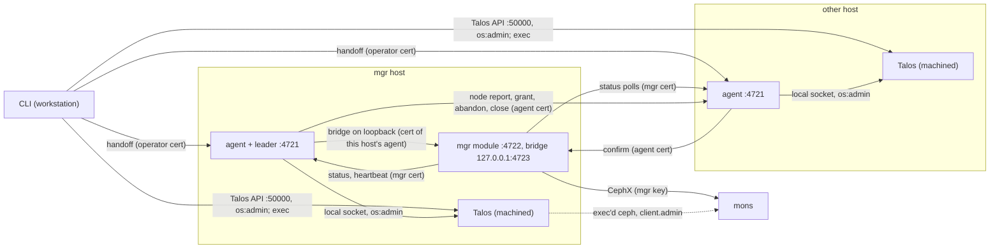
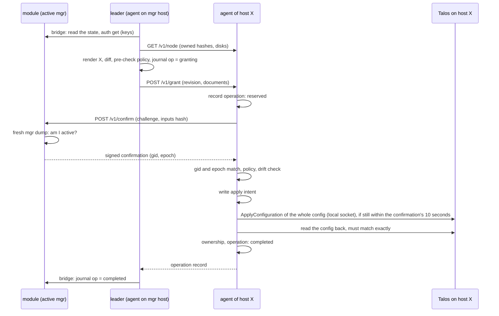

# How cephadm-talos works: components, channels and security

This document describes what is built today (branch `plan-03-write-path`, plan 03 up to step 6a, and from 6b the secrets kept apart, the bridge on loopback with its write checks, and the ledger with `ceph orch daemon restart` and `redeploy`) so that its security can be judged. Where something is planned but not built, it says so. The plan is [plans/03-write-path.md](plans/03-write-path.md); fixes for the gaps listed at the end are on the [roadmap](../ROADMAP.md) (milestone 4).

## Components

| Component | Runs where | Holds | Can do |
|---|---|---|---|
| CLI (`cephadm-talos`) | the operator's workstation | a talosconfig per node (`os:admin`), the `client.admin` key, the operator certificate and key, the fsid | everything on every node through the Talos API, and anything in Ceph through `shell`. Before the handoff it writes the cluster state; after it, its own orchestration commands refuse to change anything, but `shell` (arbitrary commands with `client.admin`) and `rm-cluster` still work: the handoff changes who writes the state, not the operator's authority |
| Agent | one container per Ceph node: `restricted`, uid/gid 50, host network, `machinedAccess` (the local Talos socket), no Ceph binaries, no Ceph key, no talosconfig | its server and client certificate and key, the agent CA certificate, its records on the `cephadm-talos` volume | everything on its own node through the local socket. It reaches no other node's Talos API |
| Leader | code in the agent on the active mgr's host, only while that mgr's module heartbeats it | the cluster state it reads, which holds no private keys, and while rendering the secrets it reads one at a time through the bridge (see "Secrets") | send revisions (grants) to every agent; through the bridge read config-key below `mgr/cephadm/talos/`, write it below its own incarnation while the mons show that incarnation active, read daemon keys and some secrets |
| mgr module (installed as `cephadm`) | Python in the active `ceph-mgr` | the mgr's CephX key, the mgr's TLS certificates and keys | Ceph commands with the mgr's caps; accepts `ceph orch` operations into its ledger; confirms that it is the active mgr; serves the bridge; polls every agent's status |
| Talos (machined) | every node | the node's machine config, including every keyring and TLS key of its containers | runs the containers the machine config describes |
| Daemons and jobs | containers on each node | see "Where daemon keys live" | talk to the mons |

## Trust domains and transports

| Connection | Transport | Authenticated by |
|---|---|---|
| CLI to Talos API, port 50000 | gRPC over TLS | the Talos CA and the talosconfig (`os:admin`) |
| Agent to its own Talos | gRPC over a Unix socket (no TLS) | machined identifies the calling process; `machinedAccess` containers may request any role, and the agent requests `os:admin`, so its role request does not limit a compromised agent |
| Agents, module, CLI among each other: ports 4721 (agent) and 4722 (module confirmations) on all interfaces, 4723 (the bridge) on the mgr host's loopback only | HTTPS, TLS 1.3, all on the host network | client and server certificates of the agent CA, checked by role, fsid and name in the URI SAN (never the common name) |
| Module, daemons and the CLI's exec'd commands to the mons | Ceph messenger | CephX. The generated `ceph.conf` does not require the encrypted messenger mode |
| S3 clients to RGW (through the VIP or directly) | HTTPS | a certificate of the separate RGW CA the CLI generated (2 years), or the user's own |
| keepalived between VIP hosts | unicast VRRP | a shared password (`PASS` authentication, 8 characters); its health check of the local RGW uses HTTPS without verifying the certificate (`curl -k`) |

## Identities

There is one agent CA per cluster (10 years). It issues certificates (3 years) with a URI SAN `cephadm-talos://<fsid>/<role>/<name>`. Before the handoff, every CLI command renews certificates that expire within 30 days; after the handoff nothing renews them yet (plan 04). Nothing revokes a certificate: removing a host or issuing a new certificate leaves the old one valid until it expires.

| Certificate | Role / name | Use | Issued by | Private key lives in |
|---|---|---|---|---|
| agent server | `agent/<host>` | the agent's HTTPS server (4721) | CLI | the agent's document (environment), so the node's machine config; and the secret `host/<host>/agent-server.key` |
| agent client | `agent/<host>` | the agent as client: confirmations, the bridge, the leader's calls | CLI | the agent's document; the secret `host/<host>/agent-client.key` |
| mgr server | `mgr/<host>` | the module's HTTPS server (4722); its key signs confirmations | CLI | an `EtcFileConfig` on the mgr host (`/etc/ceph/talos/mgr-server.key`, mode 0600); the secret `host/<host>/mgr-server.key` |
| mgr client | `mgr/<host>` | the module as client: status polls and heartbeats | CLI | `/etc/ceph/talos/mgr-client.key` on the mgr host; the secret `host/<host>/mgr-client.key` |
| operator | `operator/admin` | the CLI: the handoff | CLI | the workstation only |
| agent CA key | | issuing all of the above | CLI | the secret `agent-ca.key` |

The module reads its client certificate and the CA for every status poll and heartbeat, but its server certificate, the CA it trusts as a server and its confirmation signing key only when it starts: a new server certificate takes effect at the next mgr restart.

### Secrets

The private keys and passwords of the cluster state are not in the published state. Each is one config-key entry below `cephadm-talos/secrets/`: `agent-ca.key`, `rgw/ca.key`, `rgw/server.key`, `rgw/vrrp` (the VRRP password) and `host/<host>/{agent-server,agent-client,mgr-server,mgr-client}.key`. The prefix is outside `mgr/`: the mgr subscribes to config-key below `mgr/`, `config/` and `device/`, keeps those values in its cache and logs them at debug level 20, but not these. The CLI writes them before it publishes the state, through exec in a Ceph daemon container with `client.admin` (`config-key set`, which the mon leaves out of its audit log), values over stdin, and removes the entries of a removed host. After the handoff the CLI reads none of them and writes none, also when it resumes an interrupted handoff.

Who can read them: `client.admin` (the CLI, `shell`), anything with the mgr's caps (config-key reads are not limited to a prefix), and the leader through the bridge's `secret get`, which releases only what the fold (see "The ledger") has: the mgr keys of a host with a mgr, `rgw/server.key` while there is an RGW, `rgw/vrrp` while there is a VIP; never the CA keys or an agent's keys. The bridge's config-key calls cannot reach them: those are limited to `mgr/cephadm/talos/`. The module reads a secret with a mon command, which the mgr does not log with its output. The leader keeps a secret only in memory while it renders a host, and refuses to render a mgr or RGW key that does not belong to its certificate.

The CLI writes the secrets before the state, so a crash in between can leave a published certificate with a new key. Its next command issues new agent and mgr certificates for keys that do not match; the next `deploy rgw` reissues a generated RGW certificate, and a user-supplied one has to be given again (`--cert`, `--key`). `handoff` refuses to start while any key does not match its certificate, since afterwards the CLI can no longer repair it and the leader would not render it. A user-supplied certificate file is published with its certificates only, whatever else it holds.

## Where daemon keys live

| Kind | Key | Where |
|---|---|---|
| mon (joining) | `mon.` with `mon allow *` | its document's environment; the mon store on the ceph volume |
| bootstrap mon | `mon.`, `client.admin`, `client.bootstrap-osd`, the first mgr's key | its document's environment, until the document is replaced by the joining template (a redeploy does it; the handoff does not yet, see "Known gaps") |
| mgr | `mgr.<id>` (caps: `mon profile mgr`, `osd allow *`, `mds allow *`) | its document's environment, and a keyring file on the ceph volume |
| OSD | `osd.<n>` | not in its document: activation reads it from the OSD's own disk |
| RGW | `client.rgw.<id>` (`mon allow rw`, `osd allow rwx`, `mgr allow rw`) | its document's environment, and a keyring file on the ceph volume |
| OSD preparation job | `client.bootstrap-osd` | its document's environment while the job exists |
| zap, image probe | none | |

Mon, mgr, OSD and RGW containers share the ceph volume (`/var/lib/ceph`), writable, and mount `/etc/ceph` read-only, so a root compromise of one daemon container can read its siblings' key files there and change their data. OSDs, OSD preparation and zap jobs are privileged with the host's `/dev`; the image probe is restricted.

Who can read machine config secrets: `MachineConfig` is a sensitive Talos resource; reading it raw needs `os:admin` (in this Talos build, `os:reader` gets no raw machine config and only redacted forms of some resource types). Anyone with `os:admin` on a node, the CLI and every agent on its own node among them, reads every key in that node's documents.

## Channels

### CLI to Talos, and through exec to the mons

The CLI applies machine config documents, reads resources (container status, disks, the machine config), files and logs, and runs commands in containers with `ContainerExec`. Every Ceph command of the CLI, also the ones that only read the cluster state when a command starts, runs in a Ceph container of a node: a mgr container, else a mon, an RGW or an OSD container. The CLI sends the `client.admin` key on stdin; the command's wrapper puts it into that command's `CEPH_ARGS` environment and runs `ceph` or a small Python/librados script, which connects to the mons as `client.admin`. So the key is never in an argument list, but it is in the environment of that process while it runs, readable to root in that container and on that node. Arguments the operator passes to `shell` are logged as given. Talos logs every exec with its arguments and the requested roles, and its exit code or error.

After the handoff the CLI's own changes are refused, and it pushes nothing to the nodes. `shell` still runs anything with `client.admin`. `rm-cluster` removes the cluster's containers and Ceph files from the nodes and the workstation's state; with `--zap` it also zaps the known OSD disks and deletes the cluster data directories. It leaves the agents' records volume and the volume declarations, and erases no credential copies elsewhere (config-key, config history).

### Agent to its own Talos (local socket)

The agent:

- reads container status, instances, images, disks and the machine config, every 30 seconds;
- applies its own node's cluster documents, only for a confirmed grant that passes its admission policy (below), and removes them on a confirmed grant;
- runs one read-only command through exec: `ceph --admin-daemon /var/run/ceph/ceph-<entity>.asok version`, for documents that pass its admission policy, up to three attempts per daemon instance until one answers.

### mgr module to agents (port 4721, mgr client certificate)

| Call | Who may call | What |
|---|---|---|
| `GET /status` | any mgr of the cluster | the agent's status record: the node's containers with states, exit codes and versions, its records' health, its ownership and drift |
| `POST /v1/heartbeat` | the mgr on the agent's own host only | every 5 seconds: the module's captured incarnation (gid and epoch). The agent is the leader while the last heartbeat names its own host and is at most 15 seconds old. The module sends heartbeats with the incarnation it captured once; it does not check every 5 seconds that it is still active |

### Agents to the module (ports 4722 and 4723, agent client certificate)

The module serves two listeners with the same server certificate and the same client certificate checks: port 4722 on all interfaces serves only confirmations, port 4723 on `127.0.0.1` serves only the bridge.

| Call | Who may call | What |
|---|---|---|
| `POST /v1/confirm` | any agent of the cluster, for its own host | the module answers only after a fresh `mgr dump` from the mons shows it is the active mgr, and signs the answer (ECDSA P-256 over the exact payload) with its mgr server key: fsid, mgr, gid, epoch, the agent's session, host, revision, operation id, inputs hash and the agent's challenge. It counts 10 seconds from the challenge. The module does not know whether the operation exists; it confirms leadership, not content |
| `POST /v1/bridge`, `GET /v1/bridge/<id>` (port 4723, loopback) | a client certificate `agent/<the mgr's host>`, from the mgr's host only: loopback takes away reach from other hosts, and the certificate gates the processes on the host, where every container on the host network (mon, OSD, RGW, keepalived) can reach loopback. The module must have captured an incarnation and opened its ledger; before every call that changes something (config-key set and rm, `auth get-or-create`) or releases a credential (`auth get`, `secret get`) it checks with a fresh `mgr dump` that this incarnation is still the active one, and refuses with 409 if not or if the mons do not answer. The check comes before the call, not atomically with it: an incarnation that becomes stale in between still lands that one call | allowlisted mon commands with fixed argument shapes and a dispatch id: `status`, `health`, `mgr dump`; config-key list and get anywhere below `mgr/cephadm/talos/` (all incarnations and `cli`), set and rm only below the module's own incarnation `mgr/cephadm/talos/inc/<gid>/`; the config-key entry limit; `ledger`, the executable operations of the module's ledger after a key, answered by the module (see "The ledger"); and, only for what the fold authorizes (see "The ledger"), `secret get` (see "Secrets"), `auth get` (`mon.`, `mgr.<id>`, `client.rgw.<id>`; never `client.admin`, `osd.<n>` or `client.bootstrap-osd`) and `auth get-or-create` for an existing `mgr.<id>` or `client.rgw.<id>` with caps fixed in the module. A deadline bounds the wait for the answer, not the command: a call that times out answers "unknown" and may still complete; outcomes are kept in memory for a while by dispatch id and are lost when the mgr restarts; a credential's outcome is never kept, as a later fetch would skip the leadership check |

The bridge refuses `client.admin` and every key of a daemon the fold does not have, but the keys it does release are broad: `mon.` (`mon allow *`) and mgr keys (`mon profile mgr`, which may change mon auth). Whoever gets them can use them against the mons directly, outside the bridge's allowlist.

### Leader to agents (port 4721, agent client certificate)

| Call | What the agent checks | What |
|---|---|---|
| `GET /v1/node` | any agent certificate of the cluster | what the agent owns (hashes), its drift, the cluster's containers on its node and its disks |
| `GET /v1/operations/<id>` | any agent certificate of the cluster | the agent's record of a grant |
| `POST /v1/grant` | the sender's certificate name equals the grant's mgr; the grant's incarnation is not below the agent's session floor; a confirmation from that mgr, at the address the grant names, carries the same gid and epoch and is still valid when the configuration is sent; the admission policy; drift | apply a revision of documents (below), or restart one daemon: a document of the cluster's daemons (mon, mgr, OSD, RGW, keepalived; not a job, the probe, the agent or records-init) that the agent owns with the hash the grant names. The agent records the instance and fences the grant's revision before it calls Talos `Restart`, which answers once the daemon was signalled; the agent reports the restart started until a newer instance exists (completed), refused on another boot or when the same instance is still current after 10 minutes, and runs no other grant until then |
| `POST /v1/abandon` | the same, confirmed | give up a grant the agent has no record of: the agent raises a revision fence so that grant can never be applied |
| `POST /v1/close` | the same, confirmed | a new incarnation raises the agent's session floor: grants, abandons and closes of earlier incarnations are refused before anything is recorded |

The agent serves one grant, abandon or close at a time. A repeated grant with the same operation id and inputs (after the session floor check and reconciliation) returns the agent's record without a new confirmation, except a reserved or refused one, which tries again with a fresh confirmation and may then apply; other inputs under the same id are refused, and an abandoned operation never runs. A close at the current floor is accepted without a confirmation.

### CLI to agents (port 4721, operator certificate)

`POST /v1/handoff`: the agent takes ownership of its node's cluster documents as they are. Only the operator certificate may call it.

## The cluster state and incarnations

The cluster state (hosts, daemons, image, RGW settings, the agent and mgr certificates, the agent CA certificate, the RGW CA and serving certificates, the module's inventory; no private keys, see "Secrets") is kept in config-key below `mgr/cephadm/talos/inc/<incarnation>/` as records plus a manifest. An incarnation is one leadership: a mgr process while it is active, identified by its gid and ordered by the mgrmap epoch at which the mons first confirmed it active (a standby promoted later can have a smaller gid). The CLI writes under `cli` until the handoff.

One writer at a time: the bridge lets each leader write only below its own incarnation, while the mons show it active; the CLI writes `cli` through exec, by convention of the code, and the operator's `shell` can write anything:

1. Before the handoff only the CLI writes, under `cli`.
2. `cephadm-talos handoff` records that it started (from then on the CLI changes nothing but the handoff), hands every node to its agent, and publishes its state one last time, sealed.
3. A leader takes its baseline from the sealed `cli` state, or from the newest earlier incarnation that published, copies it under its own incarnation, and writes only there.
4. Readers (the module's inventory, the CLI) read the active mgr's incarnation once it published, else the published one with the highest epoch, else `cli`.

The leader keeps its journal under `inc/<gid>/journal/`: requests (`req/<id>`) and its operations (`op/<id>`). The leader trusts a request because it is in the store; requests are not signed, so whoever can write that config-key can submit one. Rendered documents never go into the journal, only their hashes.

## The ledger

The module's ledger is its record of the `ceph orch` operations it accepted: one config-key entry per operation below `cephadm-talos/ledger/`, outside `mgr/` (the mgr does not cache or log it, and the bridge's store calls cannot reach it), written by the module with `config-key set`, whose result it sees, and never overwritten. An entry holds the whole operation: id, kind, daemon, host, and the gid, epoch and sequence number of the incarnation that accepted it. The module accepts an operation only while a fresh `mgr dump` shows its incarnation active, after checking its arguments and that no other operation on the same daemon is unfinished in the leader's journal (a lying journal can only make it refuse commands); entries go out one at a time, and one whose write the mons did not answer is written again, the same key with the same content, by the module's heartbeat loop and before anything else is accepted. Today it accepts `ceph orch daemon restart` and `ceph orch daemon redeploy` (without an image or `--force`); `ceph orch talos operation <id>` shows an operation's entry and the leader's journal record.

Right after it captured its incarnation, before it accepts anything, the module writes a takeover entry with the highest sequence number of every incarnation since the previous takeover entry. Every reader walks the incarnations in epoch order and counts an entry, takeover entries included, only if the first later valid takeover entry has its incarnation at or above its sequence number, or no later valid takeover entry exists. So an operation a stale module appends after its successor took over is void for every reader.

The fold is what the module authorizes: the hosts and daemons of the CLI's sealed state (which the module reads itself and which no incarnation can write through the bridge), changed by the executable operations (restart and redeploy change nothing). Credential calls of the bridge are checked against it.

The leader reads the executable operations through the bridge every tick and carries them out strictly one at a time, in ledger order: a restart grants the daemon's host a restart of the daemon's current instance; a redeploy is the host's revision, then the restart. After each operation it publishes its state with that operation's ledger key as `ledger_applied`, and a successor continues after it. An operation that keeps failing for 10 minutes (an unreachable agent) ends as failed, except a grant whose outcome is unknown. An operation interrupted by a takeover after its effect but before the checkpoint runs again unless a journal of any incarnation already ends it.

## What happens when

### A change to a node (today: a host revision)

Today this path runs when a host revision request is in the leader's journal (written with `ceph config-key set`, for tests); the `ceph orch` commands that will write requests come in step 6b.

"Completed" means Talos holds exactly the granted documents, not that the daemons run. Without a confirmation the agent changes nothing on its node. If the outcome of an apply is lost, the agent decides it later from the node's config: holding exactly what the apply would leave means completed; holding exactly what it held before, on another boot or 10 minutes after the apply was sent, means it did not happen; anything else stays uncertain, and the agent applies nothing more until it is resolved. This local reconciliation needs no confirmation: it only records what the node shows.

Talos has no conditional apply: the agent checks for drift, then sends the whole machine config. A writer outside cephadm-talos changing the config in between can be overwritten, also documents outside the cluster's.

### mgr failover (a new incarnation)

The new active mgr's module heartbeats its local agent, which becomes the leader. On its first ticks it closes the earlier incarnations' sessions on every agent (a confirmed close raises each agent's session floor), imports their unfinished operations (asking the agents for their outcome, or abandoning them with a fence), and publishes its baseline. A host whose session it could not close yet gets no grant.

### Quorum loss

Without the mons no new confirmation can be signed, so no new change starts. A confirmation signed just before still counts for its 10 seconds, and an apply already sent finishes. Bridge calls fail and are retried.

## Admission policy (agent)

Before applying, the agent checks every granted document and refuses anything else. It identifies the kind by the id that renders the document's name, checks each parameter's form (ids, fsid, IPs without zones, ports, keyrings holding exactly the kind's entity and a well-formed CephX key, images by digest from the repositories in the agent's own document, by-id devices of the node's disks with their serial, dependencies within the cluster on the node, mgr certificates of the agent CA for this host's mgr with the right use, an RGW certificate with its key), renders the template compiled into the agent and requires Talos's encoding of both to be identical.

What this fixes: the command, mounts, security profile, capabilities and environment of every document kind; no other image repository, no `client.admin` in a granted mon, no arbitrary file. What it does not:

- It checks the form of keys, not that a CephX key is the entity's real key in mon auth; a mgr private key only has to parse, not match its certificate; an RGW certificate is not checked for issuer or expiry; mon addresses and parameter values are not checked against the cluster state.
- Any digest of an allowed repository is admitted, not only the one the cluster runs, and the image's contents are trusted: the OSD and job templates are privileged with all of `/dev`, keepalived has network capabilities.
- A zap job needs only a disk of this node with a matching by-id link and serial; neither admission nor the zap script checks that it is an OSD of this cluster.
- Removals are not checked against templates: a confirmed grant can remove any of the node's cluster documents, including ceph.conf, mgr files and the ceph volume declaration, but not the agent, its records-init or their volume.

## Records on the node

The agent's records (ownership, operations, session floor, fence) are files of mode 0600 in a directory of uid/gid 50, mode 0700, on the `cephadm-talos` volume. They serve crash recovery and replay protection, not integrity against a compromised node: root on the node can change them, the privileged OSD preparation and zap jobs mount that volume, and OSDs, though they do not mount it, are privileged with the host's devices. Finished operation records are pruned; the bridge does not log requests.

## Security implications

- **A compromised agent is root on its node.** It can apply any config on its node, start privileged containers, read every keyring and TLS key in the node's documents, wipe disks and reboot. On its own it has no credential for other nodes' Talos APIs. For a change, other agents require a confirmation signed by the mgr identity of the sender's host with matching gid and epoch, plus admission and fencing; they cannot establish themselves that this mgr is active (see the next points). It can read other agents' node reports and operation records without a confirmation.
- **On a Talos control-plane node, a compromised agent reaches every node of that Talos cluster.** `os:admin` on the local socket allows `GenerateClientConfiguration`, which signs a talosconfig with the node's Talos CA. Use worker nodes, or nodes whose Talos CA is not shared, where that boundary matters.
- **A compromised mgr host, active or standby, can confirm.** A confirmation proves that the module holding `mgr/<host>`'s key says it is active; the agent cannot check the mgr map itself. Root on a host with a mgr has both that host's mgr and agent certificates, so it can run a confirming endpoint, become a leader for the agents and raise their session floor with an invented epoch. It also has that mgr's CephX key.
- **The leader and the active mgr hold the cluster.** The leader can grant every agent anything the admission policy admits (including removals and zaps), and through the bridge read config-key below `mgr/cephadm/talos/` and write below its own incarnation, read daemon keys including `mon.` and the mgr keys, and read the RGW serving key, the VRRP password and the mgr TLS keys while the fold (see "The ledger") has an RGW, a VIP or that host's mgr. A compromised leader therefore has the mgr's Ceph access and can impersonate a mgr host of the cluster, but it cannot issue certificates or obtain an agent's key through the bridge, and it cannot add a daemon to the fold: the module's ledger decides that, and the leader cannot write it. The active mgr itself, with its caps, reads every secret, the agent CA key included. This is comparable to cephadm's mgr, which holds SSH root to every host.
- **Confirmations, fences and session floors protect correctness**: they stop a stale leader, not a malicious one with valid certificates.
- **The CLI's workstation holds full control**: `os:admin` on every node and `client.admin`, before and after the handoff, like a cephadm admin host.
- **`os:admin` on a node reads that node's secrets** in the machine config: daemon keyrings, the agent's TLS keys and, on a mgr host, the mgr's TLS keys.

## Known gaps

Each is on the [roadmap](../ROADMAP.md), milestone 4, with where it is fixed, unless it says it is accepted.

- **Secrets readable by the mgr**: the secrets are out of the published state, but the mgr's caps and `client.admin` read every config-key entry, the agent CA key included. A compromised mgr can issue certificates.
- **The bridge** releases the keys of every daemon in the fold, not only those of the operation being carried out; its leadership check before a call is not atomic with the call.
- **The ledger** is read in one `config-key dump` of at most 256 KiB, about a thousand operations; it has no compaction yet (plan 04).
- **The bootstrap mon's document keeps `client.admin`** and the first keys until it is redeployed; the handoff does not replace it yet.
- **Confirmations are not bound to the active incarnation**: a mgr host's certificates are enough to confirm.
- **Admission** admits any digest of an allowed repository, does not match mgr keys to certificates or check RGW certificates, and admits a zap of any disk of the node.
- **No revocation** of certificates and no renewal after the handoff; the module reloads its server identity and signing key only on restart. Generated RGW certificates (2 years) are reissued when their names change, not before they expire.
- **No messenger encryption** is configured for Ceph.
- **Talos has no conditional apply**, so the drift check and the apply are not atomic. The feature request is drafted but not filed (Omni users do not need it); until then this is an accepted limitation of the single-writer convention, not scheduled for a fix.
- **Workload isolation must be off on Ceph nodes** until Talos PR #14603 is released.
- **The CLI assumes one workstation and one command at a time.**

## Not built yet

`ceph orch` commands that add or remove daemons and hosts (step 6b slice B on); the leader running jobs (OSD preparation and zap: the agents already admit their documents); control-plane safety (maintenance, reboot, upgrade through the leader); CLI request ids and suspension for recovery (step 7); enrollment of new nodes by the leader and certificate renewal (plan 04).
