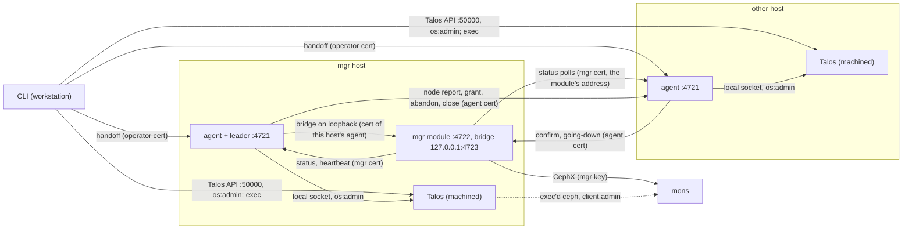
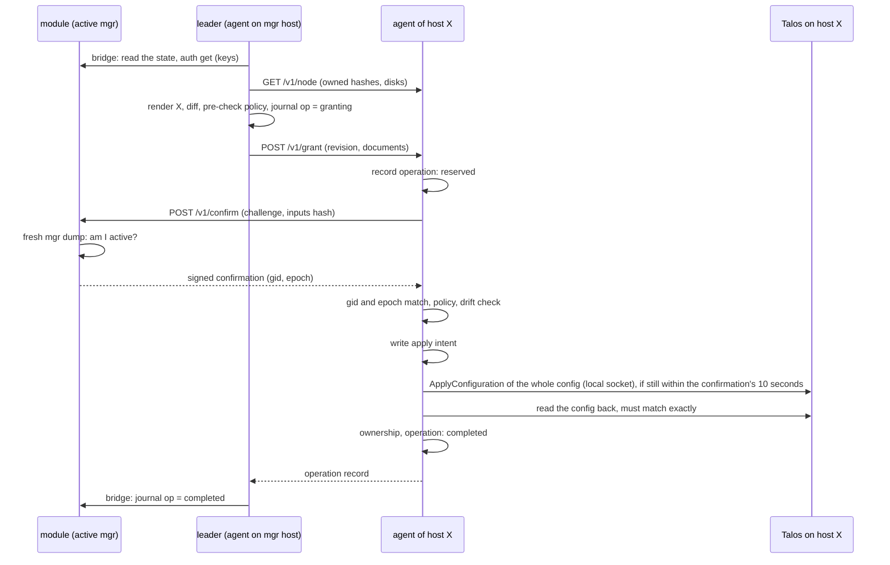

# How cephadm-talos works: components, channels and security

This document describes what is built today (branch `plan-03-write-path`, plan 03 up to step 6a, and from 6b the secrets kept apart, the bridge on loopback with its write checks, and the ledger with `ceph orch daemon restart`, `redeploy`, `daemon add` of a mon or mgr, `daemon rm` of a mgr and `host rm`; and from 6c the operator's approvals of images and disks, jobs through the agents, `ceph orch daemon add osd` and `ceph orch osd rm`; and from 6d `daemon rm` of a mon `ceph orch host maintenance enter` and `exit`, `ceph orch hardware powercycle`, `ceph orch upgrade`, from 6e RGWs and the keepalived-only ingress, and from step 7 the bootstrap mon's rendering replaced at the handoff enrollment with `ceph orch host add`, and request uuids for `ceph orch`) so that its security can be judged. Where something is planned but not built, it says so. The plan is [plans/03-write-path.md](plans/03-write-path.md); fixes for the gaps listed at the end are on the [roadmap](../ROADMAP.md) (milestone 4).

## Components

| Component | Runs where | Holds | Can do |
|---|---|---|---|
| CLI (`cephadm-talos`) | the operator's workstation | a talosconfig per node (`os:admin`), the `client.admin` key, the operator certificate and key, the fsid | everything on every node through the Talos API, and anything in Ceph through `shell`. Before the handoff it writes the cluster state; after it, its own orchestration commands refuse to change anything, but `shell` (arbitrary commands with `client.admin`) and `rm-cluster` still work: the handoff changes who writes the state, not the operator's authority |
| Agent | one container per Ceph node: `restricted`, uid/gid 50, host network, `machinedAccess` (the local Talos socket), no Ceph binaries, no Ceph key, no talosconfig | its server and client certificate and key, the agent CA certificate, its records on the `cephadm-talos` volume | everything on its own node through the local socket. It reaches no other node's Talos API |
| Leader | code in the agent on the active mgr's host, only while that mgr's module heartbeats it | the cluster state it reads, which holds no private keys, and while rendering the secrets it reads one at a time through the bridge (see "Secrets") | send revisions (grants) to every agent; through the bridge read config-key below `mgr/cephadm/talos/`, write it below its own incarnation while the mons show that incarnation active, read daemon keys and some secrets |
| mgr module (installed as `cephadm`) | Python in the active `ceph-mgr` | the mgr's CephX key, the mgr's TLS certificates and keys | Ceph commands with the mgr's caps; accepts `ceph orch` operations into its ledger; confirms that it is the active mgr; serves the bridge; polls every agent's status |
| Talos (machined) | every node | the node's machine config, including every keyring and TLS key of its containers | runs the containers the machine config describes |
| Daemons and jobs | containers on each node | see "Where daemon keys live" | talk to the mons |

## Trust domains and transports

| Connection | Transport | Authenticated by |
|---|---|---|
| CLI to Talos API, port 50000 | gRPC over TLS | the Talos CA and the talosconfig (`os:admin`) |
| Agent to its own Talos | gRPC over a Unix socket (no TLS) | machined identifies the calling process; `machinedAccess` containers may request any role, and the agent requests `os:admin`, so its role request does not limit a compromised agent |
| Agents, module, CLI among each other: ports 4721 (agent) and 4722 (module confirmations) on all interfaces, 4723 (the bridge) on the mgr host's loopback only | HTTPS, TLS 1.3, all on the host network | client and server certificates of the agent CA, checked by role, fsid and name in the URI SAN (never the common name), and against the agent CA's revocation list (see "Revocation"). A client verifies the server's chain against the agent CA (server use, validity) but not the address it dialled, which the certificate's IP SANs need not name (plan 04, step 5): a host that moved stays reachable before its certificates are reissued. Only the leader's bridge call on loopback also checks the mgr's host name |
| Module, daemons and the CLI's exec'd commands to the mons | Ceph messenger | CephX. The generated `ceph.conf` does not require the encrypted messenger mode |
| S3 clients to RGW (through the VIP or directly) | HTTPS | a certificate of the separate RGW CA (1 year, as browsers accept at most 398 days; renewed by the module 30 days before expiry), or the user's own |
| keepalived between VIP hosts | unicast VRRP | a shared password (`PASS` authentication, 8 characters); its health check of the local RGW uses HTTPS without verifying the certificate (`curl -k`) |

## Identities

There is one agent CA per cluster (10 years). It issues certificates (3 years) with a URI SAN `cephadm-talos://<fsid>/<role>/<name>`. Before the handoff, every CLI command renews certificates that expire within 30 days. After the handoff the module renews the mgr certificates (plan 04, step 1) and the CLI renews the operator certificate on any command within 60 days of its expiry, reading the agent CA key through exec; it keeps a public copy at `cephadm-talos/operator.crt` in config-key, from which the module warns (`TALOS_OPERATOR_CERT_EXPIRING`) 60 days ahead. An expired operator certificate makes `suspend` take every node through Talos. After the handoff the module also renews the agents' certificates (plan 04, step 2, `renew_agent` in "The ledger"): it issues them, and each agent installs its own through a self-update grant (see "The agent's own documents"). A certificate retired before its expiry is revoked: the module issues a revocation list of the agent CA and every verifier refuses what it names (see "Revocation").

| Certificate | Role / name | Use | Issued by | Private key lives in |
|---|---|---|---|---|
| agent server | `agent/<host>` | the agent's HTTPS server (4721) | CLI; after the handoff the module, for a renewal | the agent's document (environment), so the node's machine config; and the secret `host/<host>/agent-server.key`, or the renewal's `issued/<op>/<attempt>/agent-server.key` (the state's `AgentKeys`) |
| agent client | `agent/<host>` | the agent as client: confirmations, the bridge, the leader's calls | CLI; after the handoff the module, for a renewal | the agent's document; the secret `host/<host>/agent-client.key`, or the renewal's `issued/<op>/<attempt>/agent-client.key` |
| mgr server | `mgr/<host>` | the module's HTTPS server (4722); its key signs confirmations | CLI | an `EtcFileConfig` on the mgr host (`/etc/ceph/talos/mgr-server.key`, mode 0600); the secret `host/<host>/mgr-server.key` |
| mgr client | `mgr/<host>` | the module as client: status polls and heartbeats | CLI | `/etc/ceph/talos/mgr-client.key` on the mgr host; the secret `host/<host>/mgr-client.key` |
| operator | `operator/admin` | the CLI: the handoff | CLI | the workstation only |
| approval key (Ed25519, not of the agent CA) | | signs the operator's approvals of images and disks (see "Approvals") | CLI, at bootstrap | the workstation only; its public key is in every agent's document |
| agent CA key | | issuing all of the above | CLI | the secret `agent-ca.key` |

The module reads its client certificate and the CA for every status poll and heartbeat, and its server certificate, the CA it trusts as a server and its confirmation signing key whenever their files change (checked every 5 seconds): it loads the three from one read and replaces them as one object; each connection keeps the object it was accepted with and signs its confirmations with that object's key, so the key always matches the certificate the agent saw in that handshake. A load that fails keeps the old one.

### Secrets

The private keys and passwords of the cluster state are not in the published state. Each is one config-key entry below `cephadm-talos/secrets/`: `agent-ca.key`, `rgw/ca.key`, `rgw/server.key`, `rgw/vrrp` (the VRRP password) and `host/<host>/{agent-server,agent-client,mgr-server,mgr-client}.key`; after the handoff the module adds the keys it issues (`issued/<op>/<attempt>/{mgr-server,mgr-client,agent-server,agent-client,rgw-server}.key`, an issued certificate beside its key, `.crt` for `.key`, so a retirement can revoke it), the operator's RGW key from `daemon add -i` (`user/<op>/rgw-server.key`, written at acceptance), an ingress's VRRP password (`ingress/<op>/vrrp`, written at acceptance) and, if the CLI made none, its own RGW CA (`rgw/ca.pem`, certificate and key in one entry, written once). The prefix is outside `mgr/`: the mgr subscribes to config-key below `mgr/`, `config/` and `device/`, keeps those values in its cache and logs them at debug level 20, but not these. The CLI writes them before it publishes the state, through exec in a Ceph daemon container with `client.admin` (`config-key set`, which the mon leaves out of its audit log), values over stdin, and removes the entries of a removed host. After the handoff the CLI reads none of them and writes none, also when it resumes an interrupted handoff.

Who can read them: `client.admin` (the CLI, `shell`), anything with the mgr's caps (config-key reads are not limited to a prefix), and the leader through the bridge's `secret get`, which releases only what the fold (see "The ledger") has: the mgr keys of a host with a mgr, the key of an RGW certificate of the fold not retired yet (the CLI's `rgw/server.key`, a generated or the operator's) while there is an RGW, the current VRRP password (the CLI's `rgw/vrrp`, or the newest ingress's that set one) while there is a keepalived, and a host's agent keys of a renewal (`renew_agent`) to the leader carrying out that renewal, until a later `agent_cert_done` retired them; never the CA keys or the CLI's agent keys. The bridge's config-key calls cannot reach them: those are limited to `mgr/cephadm/talos/`. The module reads a secret with a mon command, which the mgr does not log with its output. The leader keeps a secret only in memory while it renders a host, and refuses to render a mgr or RGW key that does not belong to its certificate.

The CLI writes the secrets before the state, so a crash in between can leave a published certificate with a new key. Its next command issues new agent and mgr certificates for keys that do not match; the next `deploy rgw` reissues a generated RGW certificate, and a user-supplied one has to be given again (`--cert`, `--key`). `handoff` refuses to start while any key does not match its certificate, since afterwards the CLI can no longer repair it and the leader would not render it. A user-supplied certificate file is published with its certificates only, whatever else it holds.

## Where daemon keys live

| Kind | Key | Where |
|---|---|---|
| mon (joining) | `mon.` with `mon allow *` | its document's environment; the mon store on the ceph volume |
| bootstrap mon | `mon.`, `client.admin`, `client.bootstrap-osd`, the first mgr's key | its document's environment until the handoff, which replaces it with the joining template (only `mon.`) before it hands the host over and waits for the mon back in the quorum; afterwards `client.admin` is on the workstation only |
| mgr | `mgr.<id>` (caps: `mon profile mgr`, `osd allow *`, `mds allow *`) | its document's environment, and a keyring file on the ceph volume |
| OSD | `osd.<n>` | not in its document: activation reads it from the OSD's own disk |
| RGW | `client.rgw.<id>` (`mon allow rw`, `osd allow rwx`, `mgr allow rw`) | its document's environment, and a keyring file on the ceph volume |
| OSD preparation job | `client.bootstrap-osd` | its document's environment while the job exists |
| zap, image probe | none | |

Mon, mgr, OSD and RGW containers share the ceph volume (`/var/lib/ceph`), writable, and mount `/etc/ceph` read-only, so a root compromise of one daemon container can read its siblings' key files there and change their data. OSDs, OSD preparation and zap jobs are privileged with the host's `/dev`; the image probe is restricted.

Who can read machine config secrets: `MachineConfig` is a sensitive Talos resource; reading it raw needs `os:admin` (in this Talos build, `os:reader` gets no raw machine config and only redacted forms of some resource types). Anyone with `os:admin` on a node, the CLI and every agent on its own node among them, reads every key in that node's documents.

## Channels

### CLI to Talos, and through exec to the mons

The CLI applies machine config documents, reads resources (container status, disks, the machine config), files and logs, and runs commands in containers with `ContainerExec`. Every Ceph command of the CLI, also the ones that only read the cluster state when a command starts, runs in a Ceph container of a node: a mgr container, else a mon, an RGW or an OSD container. The CLI sends the `client.admin` key on stdin; the command's wrapper puts it into that command's `CEPH_ARGS` environment and runs `ceph` or a small Python/librados script, which connects to the mons as `client.admin`. So the key is never in an argument list, but it is in the environment of that process while it runs, readable to root in that container and on that node. Arguments the operator passes to `shell` are logged as given. Talos logs every exec with its arguments and the requested roles, and its exit code or error.

After the handoff the CLI's own changes are refused, and it pushes nothing to the nodes; it still signs and publishes approvals (`cephadm-talos approve`, see "Approvals"). `cephadm-talos suspend` writes the control record `cephadm-talos/suspension {session}` (outside `mgr/`, out of the bridge's reach) through exec when the mons answer, and then suspends every agent (see "CLI to agents") of the hosts in the cluster state, the workstation's contacts and the enrollment records, reading them again until no host is left without a receipt (an accepted `host add` may add one meanwhile). For an agent that does not answer (no connection, or none within 30 seconds; a wrong certificate or TLS error is an error, not a reason) it suspends the node itself with `os:admin`: it journals the agent's certificates and pinned inputs (repositories, approval key) from its document and the secret names of its keys (the state's `AgentKeys`; for a host the state does not have, those of the module's renewal whose certificate, kept in the secrets beside its key, is the one in the agent's document, else the CLI's; left for the resumption to find the same way if the secrets cannot be read), removes the agent's document and waits until every instance is gone, runs a recovery job (the agent binary as uid 50 with only the records volume: `records`) that reports the agent's records, waits until an apply the agent sent may no longer land (`ApplySettle` on the same boot, or with `--reboot` reboots the node), waits for a job, reboot or restart the agent started (or with `--force` removes such a job whose apply the agent's ownership shows with no apply intent left, its removal journaled; the agent decides its operation from the job's result file once its document and instances are gone; a job whose apply the agent did not record is waited for, as its removal would make the agent's reconcile take the apply for refused), removes the agent document again if an earlier apply brought it back, and only then runs the recovery job again to write the suspension record and the receipt. The CLI keeps a journal of the session (`recovery.json` next to `local.json`, mode 0600, synced before each effect): the phase, every host it found with its address (recorded before any is suspended, so a retry without the mons still asks each), the receipts, and the id of each job it runs, recorded before the job's document is applied and reused by a retry. It also keeps the agent CA's certificate and the agent image in `local.json` (public), so it can suspend without the mons.

`cephadm-talos recover mons [--image]` brings the mons of a suspended cluster back on their existing stores, without the cluster state: from the hosts this workstation and the session know, each node's documents (the full fsid of its `ceph.conf` and of every document checked), the agents' receipts and the stores. A mon's document must be that host's mon of the cluster on the Ceph volume, with exactly that one mount at `/var/lib/ceph` and nothing mounted at an ancestor or a descendant of it (clean paths only), and an image by digest (`--image` too), and every host must have a receipt of the session before anything is touched. A running mon is left alone. Every other mon is inspected first by a journaled job (privileged, read-only use of the Ceph volume) that reads its store's deployment marker exactly (one that is not a plain deployment id is refused), as the mon's entrypoint deletes a store whose marker differs from `DEPLOY_ID`: a mon whose document is there is restarted through Talos only if its marker equals the document's deployment id, and a mon whose document went missing is applied again (joining, the marker's deployment id, the node's Ceph image or `--image`, no key: the store has it) only if its agent's receipt still owns that document, so the leftover store of a mon removed through the leader is never brought back. Anything else (no store, no marker, another marker, no ownership) fails for that mon; the CLI never runs mkfs, injects a monmap or creates or reads a key. An uncertain operation of the node (an apply, a job whose document the ownership does not show applied, or a reboot), an apply intent the agent left (the receipt says so) or of the mon (a restart), or an open bridge intent on it in any host's receipt, blocks that mon. A document it applies is journaled first with its hash as the agent computes it (Talos's encoding), and the node's must equal it afterwards; a retry finds a different document under that name an error. Every run inspects afresh with a new journaled job (a job replays its result under the same id), removing an inspection an earlier run left behind. It then waits for a quorum through exec into a mgr or mon container, trying every node that runs one. `shell` without the cluster state (no mon answers, or a suspended recovery) execs into a node with a running mgr or mon container of the cluster, and the CLI writes nothing. `shell` still runs anything with `client.admin`. `rm-cluster` removes the cluster's containers and Ceph files from the nodes and the workstation's state; with `--zap` it also zaps the known OSD disks and deletes the cluster data directories. A cluster its agents may own (handed over, or a state that cannot be read while the workstation has the agents' credentials) is suspended first (`suspend`, with its `--reboot` and `--force`), so no grant, job or leader tick races the removal. The zap targets are fixed after the suspension, while the mons answer: the OSDs of the cluster state read again, the disks of the preparation and zap jobs configured on the nodes, and every disk a preparation used on a host (the receipts list them from the agents' approval records), the last zapped only if it carries a BlueStore label of this cluster and left as it is otherwise; a disk of the state or a job without a known serial refuses `--zap` before anything is removed. The removal (with or without `--zap`, the job image, the targets) and the id of each zap and data job are journaled first, and the end of the document removal once every instance is gone: an interrupted removal continues as it was started (a retry with the other `--zap` is refused), with the same targets and job ids; it does not remove its own zap and data jobs again, and a zap or data job that has not ended when the CLI stops is left running for the retry to wait for. The removal holds the workstation's lock throughout; the journal goes with the workstation's state at the end. It leaves the agents' records volume and the volume declarations, and erases no credential copies elsewhere (config-key, config history).

`cephadm-talos resume` ends a suspended or recovering session once the mons answer, from the published cluster state, each step journaled before its effect and continued by a retry. It first checks what the recovery changed against the published state, before the session's phase moves on (a refusal leaves `recover mons` open): every document it applied must be confirmed, and each one it applied or restarted (`recover mons` journals a restart before it) must be a mon or mgr the state names on that host, with the state's deployment id, id, fsid and the host's address, the host not in maintenance; the only removal allowed is a job document the suspension removed with `--force`, which is journaled before its removal. Recovery never writes the cluster state, and a recovery that would have to (drop a mon, change an address) is out of scope. It writes the control record if it is missing, applies the agent documents the suspension removed (keys from the secrets, read through exec with `client.admin`, by the state's `AgentKeys` or the journaled names; certificates from the state, else the journal, which records them from the agent's document before the removal (a host the leader removed), else an enrollment record; the pinned inputs the journal recorded, else the state's; the apply journaled and an interrupted self-update settled as `agent restore` does (below), and an apply a restore journaled that landed is finished as rendered, not rendered again; the agent starts suspended from its records and must answer with the receipt's revision, or the revision of an unresolved operation of the receipt that it reconciled, whose receipt then replaces the journaled one), removes the documents of the session's own jobs and waits until their instances are gone, and asks every agent to re-adopt its node with the session's journaled changes on it (`POST /v1/readopt`), journaling each receipt. Then, while every agent is still suspended, it journals the mgr map's epoch and gids and every mgr container's current instance, restarts each through Talos (asking again only after two minutes, as Talos first stops the instance within its stop timeout) until a newer instance runs, fails the active mgr by its gid (`ceph mgr fail <gid>`) while it is one of before, and journals the first active mgr whose gid is not: no mgr process of before is left to hold a bridge handler or a tick. It then activates every agent with that epoch (`POST /v1/activate`), removes the control record, and waits until the active mgr, a gid not of before, has published its takeover; the journal goes at the end (a journal left at `resumed` counts as ended, and the next session's replaces it). Once a re-adoption began, a retry goes through the journaled hosts only and does not check the changes of a host already re-adopted again: once activated, the leader may have changed the state and its hosts. The new leader's takeover closes the earlier sessions on every host and imports the earlier journals, as at any failover.

`cephadm-talos agent restore <host> [--previous]` (plan 04, step 2) brings back an agent that a self-update or upgrade left broken, as part of a recovery session: only while the session is suspended or recovering, or resuming before any agent was re-adopted or activated (so a resumption's restored image that does not start is rolled back with `--previous`), and the host has its receipt (its agent suspended, or removed by the suspension). It applies the host's agent documents, the CLI's own, rendered from the state's certificates (keys by `AgentKeys`), the pinned inputs the suspension journaled or, without them, those of the agent's current document on the node, and the agents' image, or with `--previous` the known good: an unfinished agent upgrade's from-image, else `Agent.PreviousImage`; never an old document whole. Documents the node already holds are recorded as applied without a patch; otherwise the apply is journaled first with its documents' hashes as the agent computes them and a deadline for its dispatch (2 minutes; after it the patch is not sent), and decided from the node's config, as the recovery's mon documents are: applied once the node holds them, not on another boot or `ApplySettle` after that deadline. While its outcome is unknown the node is reserved: a retry, `resume`, `recover mons` and `rm-cluster` refuse it. When the receipt has an undecided apply intent, a records job (uid 50, the records volume only) then settles it if it is marked as a self-update, which neither rendering may match and which would block the re-adoption: it records the self-update's operation as failed (superseded by the restore), fences its revision and removes the intent; a cluster apply's intent is never settled so. The restored agent starts suspended from its records and must answer for the session at its receipt's revision; the restore then checks that its container runs the intended image's digest and that it serves the state's certificate, and journals it as restored, so `resume` does not apply it again.

### Agent to its own Talos (local socket)

The agent:

- reads container status, instances, images, disks and the machine config, every 30 seconds;
- applies its own node's cluster documents, only for a confirmed grant that passes its admission policy (below), and removes them on a confirmed grant;
- applies its own agent and records-init documents, only for a confirmed self-update that passes its own checks (see "The agent's own documents"), and pulls an image only for a confirmed pull grant;
- runs one read-only command through exec: `ceph --admin-daemon /var/run/ceph/ceph-<entity>.asok version`, for documents that pass its admission policy, up to three attempts per daemon instance until one answers;
- watches its node's `MachineStatus` (a COSI watch) and the machine events (`Events`, its sequence events) to follow the node's stop sequences (reboot, shutdown, upgrade, reset) and reads the boot id (plan 04, step 5, "Unplanned stops").

### mgr module to agents (port 4721, mgr client certificate)

| Call | Who may call | What |
|---|---|---|
| `GET /status` | any mgr of the cluster | the agent's status record: the node's containers with states, exit codes and versions, its records' health, its ownership and drift, the node's boot id and the id of the last stop it reported once that stop was evidently cancelled. The poll names the polling module's address in a header (`X-Cephadm-Talos-Module`); the agent keeps it with the mgr its client certificate names, as where it sends its going-down reports |
| `POST /v1/crl {crl}` | any certificate of the agent CA the agent's list does not name, also while the agent is suspended or fails closed | installs a newer revocation list (see "Revocation"); the module sends it with its status poll |
| `POST /v1/heartbeat` | the mgr on the agent's own host only | over loopback (`127.0.0.1`, not the host's published address, so a move of the host never cuts the leader off), every 5 seconds: the module's captured incarnation (gid and epoch). The agent is the leader while the last heartbeat names its own host and is at most 15 seconds old. The module sends heartbeats with the incarnation it captured once; it does not check every 5 seconds that it is still active |

### Agents to the module (ports 4722 and 4723, agent client certificate)

The module serves two listeners with the same server certificate and the same client certificate checks: port 4722 on all interfaces serves only confirmations and going-down reports, port 4723 on `127.0.0.1` serves only the bridge.

| Call | Who may call | What |
|---|---|---|
| `POST /v1/confirm` | any agent of the cluster, for its own host | the module answers only after a fresh `mgr dump` from the mons shows it is the active mgr, and signs the answer (ECDSA P-256 over the exact payload) with its mgr server key: fsid, mgr, gid, epoch, the agent's session, host, revision, operation id, inputs hash and the agent's challenge. It counts 10 seconds from the challenge. The module does not know whether the operation exists; it confirms leadership, not content |
| `POST /v1/going-down {boot, stop}` | any agent of the cluster, for its own host (the body's host must be its certificate's, and a host of the fold) | the agent's node runs a stop sequence (plan 04, step 5): the module, if a fresh `mgr dump` shows it active, records an unplanned stop of that host with the boot id and the stop's id (`host_down`) once per stop id and wakes its noout pass. The stop id is the agent's: its boot id, a nonce of the agent process and a counter of its stop signals, so a later stop on the same boot, also after the agent restarted, is never taken for an earlier one. The agent sends it to the mgr that polled it last, verifying that mgr's certificate identity (a wrong address only fails), at once and retried every second for 2 minutes, also past its own stop |
| `POST /v1/bridge`, `GET /v1/bridge/<id>` (port 4723, loopback) | a client certificate `agent/<the mgr's host>`, from the mgr's host only: loopback takes away reach from other hosts, and the certificate gates the processes on the host, where every container on the host network (mon, OSD, RGW, keepalived) can reach loopback. The module must have captured an incarnation and opened its ledger; before every call that changes something (config-key set and rm, `auth get-or-create`) or releases a credential (`auth get`, `secret get`) it checks with a fresh `mgr dump` that this incarnation is still the active one, and refuses with 409 if not or if the mons do not answer. The check comes before the call, not atomically with it: an incarnation that becomes stale in between still lands that one call | allowlisted mon commands with fixed argument shapes and a dispatch id: `status`, `health`, `mgr dump`; config-key list and get anywhere below `mgr/cephadm/talos/` (all incarnations and `cli`), set and rm only below the module's own incarnation `mgr/cephadm/talos/inc/<gid>/`; the config-key entry limit; `approval`, the newest approval in config-key, answered by the module; `ledger`, the executable operations of the module's ledger after a key, answered by the module (see "The ledger"); `osd dump` reduced to each OSD's id, uuid and state; and, only for what the fold authorizes (see "The ledger"), `secret get` (see "Secrets"), `auth get` (`mon.`, `mgr.<id>`, `client.rgw.<id>`, and `client.bootstrap-osd` for a bound, unfinished OSD creation it names; never `client.admin` or `osd.<n>`) and `auth get-or-create` of a `mgr.<id>` or `client.rgw.<id>` an accepted add deploys (it names the add), with caps fixed in the module; module-answered calls for the ledger's operations: `mgr cert`, `retire`, `retire host`, `mon rm`, `bind disk`, `confirm osd`, `close create`, `osd out`, `drain`, `ok to stop`, `noout set`, `noout unset`, `maintained`, `mgr fail`, `ok to stop daemon`, `upgrade done`, `upgrade refused`, `rgw cert`, `rgw cert done`, `retire keepalived`, `agent cert`, `agent cert done` and `drain done`, `addr moved`, `addr set`, `move addr` (a host's move, plan 04 step 5) and `clear osd addr` (an OSD creation); `osd out`, `drain`, `retire` and `mon rm` also take a drain step's `daemon`, `mon rm` a move's mon (see "The ledger"). A deadline bounds the wait for the answer, not the command: a call that times out answers "unknown" and may still complete; outcomes are kept in memory for a while by dispatch id and are lost when the mgr restarts, those of module-answered calls and `auth get-or-create` too; a module-answered call refuses (non-200) only when it sent nothing, and one that sent a command and then failed answers done with its error; a credential is never kept with an outcome, as a later fetch would skip the leadership check |

The bridge refuses `client.admin` and every key of a daemon the fold does not have, but the keys it does release are broad: `mon.` (`mon allow *`) and mgr keys (`mon profile mgr`, which may change mon auth). Whoever gets them can use them against the mons directly, outside the bridge's allowlist.

### Leader to agents (port 4721, agent client certificate)

| Call | What the agent checks | What |
|---|---|---|
| `GET /v1/node` | any agent certificate of the cluster | what the agent owns (hashes), its drift, the cluster's containers on its node with their newest instance, the image digest of those running and each keepalived's VRRP state (from its log), its disks, and its boot id |
| `GET /v1/operations/<id>` | any agent certificate of the cluster | the agent's record of a grant |
| `POST /v1/grant` | the operator's approval the grant carries verifies with the agent's pinned key and is not older than the agent's; the sender's certificate name equals the grant's mgr; the grant's incarnation is not below the agent's session floor; a confirmation from that mgr, at the address the grant names, carries the same gid and epoch and is still valid when the configuration is sent; the admission policy; drift | apply a revision of documents (below), or restart one daemon: a document of the cluster's daemons (mon, mgr, OSD, RGW, keepalived; not a job, the probe, the agent or records-init) that the agent owns with the hash the grant names. The agent records the instance and fences the grant's revision before it calls Talos `Restart`, which answers once the daemon was signalled; the agent reports the restart started until a newer instance exists (completed), refused on another boot or when the same instance is still current after 10 minutes, uncertain when the old instance is gone and no newer one came within 10 minutes, and runs no other grant until then; or reboot its own node, only when the node, without drift, holds no daemon document of the cluster (its host in maintenance): the agent records the boot id and fences the revision before it calls Talos `Reboot`, reports the reboot started (uncertain if the call had no answer), completed once the node runs another boot, and refused if Talos refused the call or the node is still on the same boot after 20 minutes; or update the agent's own documents (a self-update, see "The agent's own documents"); or pull an image on its own node (a pull grant: by digest, in the agent's highest approval and from the repository of its own image, pulled through its socket within the grant; one that fails or that a stop interrupts is refused and may be granted again). A self-update and a pull are refused while the agent is suspended, as every grant is |
| `POST /v1/abandon` | the same, confirmed | give up a grant the agent has no record of: the agent raises a revision fence so that grant can never be applied |
| `POST /v1/close` | the same, confirmed | a new incarnation raises the agent's session floor: grants, abandons and closes of earlier incarnations are refused before anything is recorded |

The agent serves one grant, abandon or close at a time. A repeated grant with the same operation id and inputs (after the session floor check and reconciliation) returns the agent's record without a new confirmation, except a reserved or refused one, which tries again with a fresh confirmation and may then apply; other inputs under the same id are refused, and an abandoned operation never runs. A close at the current floor is accepted without a confirmation.

### The agent's own documents

The agent and records-init documents are the CLI's: the agent never owns them (the handoff leaves them out of its ownership), so drift and the re-adoption do not see them. After the handoff they change only through a self-update grant (plan 04, step 2), which carries their variable fields alone: an image, or the server and client certificates with their keys (all four or none). The agent renders both documents itself (`daemons.Agent`, `daemons.RecordsInit`) from those fields and its current document's pinned inputs (the agent CA, the repositories, the approval key, and for an omitted field its current image or certificates and keys); no grant changes the pinned inputs. It refuses unless the image is the one its document has, or by digest, in its highest approval and from the repository of its current image (the agent image is not one of the cluster's repositories, so the handoff's first approval names it); the certificates are issued by its agent CA for `agent/<host>` with the right use and within their validity, the server certificate for its host's name and one of the node's addresses, each key its certificate's; it is handed over, without drift, the revision above its ownership and fence, and the confirmation still counts. It then applies the documents that differ under the apply intent every apply uses, marked as a self-update with the before and sent hashes of its own documents, and fences the revision: an undecided one blocks every later apply, cluster grants included, as Talos patches the whole machine config, and the suspension's receipt and the records job see it like any apply intent. Talos replaces the agent's instance once the documents are in the config (after records-init succeeded with the new image), so the instance that patched may not answer: the next one decides the intent at its start from the node's config, as an apply's (its own documents as sent: completed; as before, on another boot or after `ApplySettle`: refused; else uncertain), writes a self-update record (the operation, the hashes applied) before it removes the intent, and the operation record follows that record. Its ownership does not change.

### CLI to agents (port 4721, operator certificate)

`POST /v1/handoff`: the agent takes ownership of its node's cluster documents as they are. Only the operator certificate may call it.

`POST /v1/policy` (operator certificate only): an approval the operator signed with the `crl` field (`cephadm-talos crl-policy closed|open`) sets the agent's revocation list policy (see "Revocation").

`POST /v1/readopt {session, changes}` (operator certificate only): a suspended agent takes ownership of its node again at the resumption (an agent whose enrollment stopped before its handoff counts as owning nothing). It refuses unless it is suspended for that session, nothing it started still runs, no apply is uncertain and its records are readable, and unless the node's cluster documents are exactly its retained ownership with the changes (each document key with the hash the CLI applied, or a removal): drift from before the suspension or a change the CLI did not journal is not adopted. It keeps every record (approval, session floor, fence, operations, tombstones, bridge intents), records the re-adoption (session, the hash of the changes, the revision and documents) before the new ownership, at a revision above the ownership, the fence and every operation's, and stays suspended. The same request again returns the same receipt while the node is unchanged; other changes for the session are refused.

`POST /v1/activate {session, revision, epoch}` (operator certificate only): ends the suspension of an agent re-adopted for that session at that revision, its ownership unchanged since. It refuses while a bridge intent of a mgr map epoch after the given one is open, and releases the others (the resumption replaced every mgr process before), then records the epoch with the re-adoption and removes the suspension record; the agent grants and runs leader ticks again, but never on a heartbeat of that epoch or before (a fresh or delayed heartbeat of a replaced mgr process; an unreadable re-adoption record counts every heartbeat as before). The same call again succeeds.

`POST /v1/resolve {operation}` and `GET /v1/resolve` (operator certificate only, also while suspended and while a fail-closed agent's list is stale; plan 04, step 4): `cephadm-talos resolve <host> <operation>` fails a job whose outcome is uncertain, named by the agent's operation id as the leader's journal names it (`op-<hex>.prep`); without an operation, and in `cephadm-talos ps`, the agent lists its jobs whose outcome is not known. See "Jobs".

`POST /v1/suspend {session}` and `GET /v1/suspend` (operator certificate only): the agent records the suspension for a recovery session (`cephadm-talos suspend`) in its records before anything else, so from then on, also after a restart, it refuses grants, closes, abandons and handoffs and runs no leader tick; a suspension of another session is refused, an unreadable suspension record counts as a suspension. It then cancels its leader's running tick and waits until it returned, takes the grant slot, reconciles, and answers 202 with what it still waits for: a job it started that has not ended (a status other than completed or failed, or, without a status, its document or an instance still there), an apply that may still land (on the same boot within `ApplySettle`; one that settled but the node cannot decide is an uncertain operation of the receipt), a reboot or restart, started or without an answer, still being decided within the 20 and 10 minutes of a grant (after them an undecided one is an uncertain operation of the receipt), or a bridge call of its tick the module reports as still running. Two suspensions at once: one session wins (an atomic claim). A handoff runs under the grant slot too, so one admitted before the suspension ends before the receipt. Once nothing it started runs it answers 200 with its receipt: the ownership revision and documents, the fence, the session floor, the operations whose outcome is uncertain, whether an apply intent it could not decide is left, the open bridge intents (see "The leader's bridge intents"), and the serials of the disks preparation jobs used on the node. Daemons keep running. Suspension does not abandon an uncertain operation; the CLI refuses work on what such an operation or intent reserves.

## The cluster state and incarnations

The cluster state (hosts, daemons, image, RGW settings, the agent and mgr certificates, the agent CA certificate, the RGW CA and serving certificates, the module's inventory; no private keys, see "Secrets") is kept in config-key below `mgr/cephadm/talos/inc/<incarnation>/` as records plus a manifest. An incarnation is one leadership: a mgr process while it is active, identified by its gid and ordered by the mgrmap epoch at which the mons first confirmed it active (a standby promoted later can have a smaller gid). The CLI writes under `cli` until the handoff.

One writer at a time: the bridge lets each leader write only below its own incarnation, while the mons show it active; the CLI writes `cli` through exec, by convention of the code, and the operator's `shell` can write anything:

1. Before the handoff only the CLI writes, under `cli`.
2. `cephadm-talos handoff` records that it started (from then on the CLI changes nothing but the handoff), hands every node to its agent, and publishes its state one last time, sealed.
3. A leader takes its baseline from the sealed `cli` state, or from the newest earlier incarnation that published, copies it under its own incarnation, and writes only there.
4. Readers (the module's inventory, the CLI) read the active mgr's incarnation once it published, else the published one with the highest epoch, else `cli`.

The leader keeps its journal under `inc/<gid>/journal/`: requests (`req/<id>`), its operations and their phases (`op/<id>`, `op/<id>.<phase>`), the steps of rolls and renewals (`roll/<id>.<...>`) and its takeover record. The leader trusts a request because it is in the store; requests are not signed, so whoever can write that config-key can submit one. Rendered documents never go into the journal, only their hashes. The active module prunes the journals of every incarnation (see "Snapshots and pruning" under "The ledger"); the bridge lets a leader write only its own.

## The ledger

The module's ledger is its record of the `ceph orch` operations it accepted: one config-key entry per operation below `cephadm-talos/ledger/`, outside `mgr/` (the mgr does not cache or log it, and the bridge's store calls cannot reach it), written by the module with `config-key set`, whose result it sees, and never overwritten. An entry holds the whole operation: id, kind, daemon, host, and the gid, epoch and sequence number of the incarnation that accepted it. The module accepts an operation only while a fresh `mgr dump` shows its incarnation active and the CLI's control record `cephadm-talos/suspension` does not exist (read before every acceptance; one it cannot read counts as present), after checking its arguments and that no other operation on the same daemon is unfinished in the leader's journal (a lying journal can only make it refuse commands); entries go out one at a time, and one whose write the mons did not answer is written again, the same key with the same content, by the module's heartbeat loop and before anything else is accepted. Today it accepts `ceph orch daemon restart` and `ceph orch daemon redeploy` (without an image or `--force`), `ceph orch daemon add mon|mgr <host>` (one daemon on one host of the cluster, no network, name or other placement), `ceph orch daemon add rgw default <host> [--port N]` and `daemon add -i` with an RGW spec carrying the operator's certificate and key (one RGW per host, one port), `ceph orch daemon rm` of mons, mgrs and RGWs (not the active mgr, not the last mon or mgr, not an RGW whose host has a keepalived), and `ceph orch host rm` of a host without daemons that does not run the active mgr (without `--offline` or `--rm-crush-entry`), `ceph orch daemon add osd <host>:/dev/<disk>` (one disk, nothing else of a drive group), `ceph orch osd rm <id>... [--zap] [--force]` (without `--replace` or `--no-destroy`), `ceph orch osd rm status`, `ceph orch host maintenance enter <host> [--force]` and `exit <host>` (without `--yes-i-really-mean-it`, or `--force` and `--offline` for exit; not on single-host clusters; no other operation on a host in maintenance), `ceph orch hardware powercycle <host> --yes-i-really-mean-it`, and `ceph orch apply -i` with one keepalived-only ingress (`rgw.default` in front of `rgw.default`, one IPv4 VIP, 1 to 15 named hosts with an RGW, optional router id and password; an existing ingress keeps its VIP, router id and password; the keepalived image is `mgr/cephadm/container_image_keepalived`, approved by the operator), `ceph orch upgrade start --image <repository>@sha256:<hex>` (the cluster's repository, an image of the operator's newest approval, no host in maintenance or draining, no other upgrade; no other option), `upgrade pause`, `resume`, `stop` and `status`; `ceph orch host drain <host> [--zap-osd-devices]` and `drain stop <host>` (see "Drain" below); `ceph orch host add <host> <addr> [--labels ...]` of a node the CLI enrolled (its enrollment record `cephadm-talos/enroll/<host>` gives the address and the agent certificates, copied into the entry); `ceph orch talos operation <id>` shows an operation's entry and the leader's journal record (for a compacted operation its row of the snapshot's lookup table). `ceph orch talos request <uuid> <inputs> -i` runs a `ceph orch` command once per request uuid: the module, under one lock, settles an unanswered append, returns the operation an executable entry or a row of the snapshot's lookup table with that uuid accepted (refusing it if the inputs hash differs), or dispatches the command through the orchestrator module with the uuid and hash recorded in the entry it accepts; commands on several daemons or specs are refused, and a daemon spec goes to this backend directly (Ceph's orchestrator module would log it whole, the operator's key included). `cephadm-talos orch [--request <uuid>] [-i <file>|-] -- <words>` parses the words with the mgr's command descriptions in a Ceph container and sends such a request, its input over stdin after the admin key.

Right after it captured its incarnation, before it accepts anything, the module writes a takeover entry with the highest sequence number of every incarnation since the previous takeover entry. Every reader walks the incarnations in epoch order and counts an entry, takeover entries included, only if the first later valid takeover entry has its incarnation at or above its sequence number, or no later valid takeover entry exists. So an operation a stale module appends after its successor took over is void for every reader.

**Snapshots and pruning** (plan 04, step 4). The module reads the ledger by key: it lists the keys in pages (`config-key ls`, reduced in the mgr) and reads them in batches of `config-key get`, failing the read unless every listed key was read, so the ledger's size does not meet the mgr's 256 KiB command output limit. It accepts no new operation while more than 500 are unfinished in the leaders' journals (counted from one scan of the journals per call), with the reason; the upgrade controls (`upgrade pause`, `resume`, `stop`, the agent upgrade's `--resume` and `--stop`) and the module's own entries are not refused. The active module compacts when more than 1000 entries follow the newest snapshot (module option `talos_compact_after`, 10 to 1000, lower only for tests), at most hourly, in a thread apart from its leadership loop:

- **The cut** is the largest key K such that every operation entry at or below it is finished (a terminal state in any incarnation's journal), at or below the published `ledger_applied` and not pinned, and every module entry at or below it names such an operation (or one an earlier snapshot covered); takeover and void entries do not hold it back. Pinned: a Ceph upgrade's start until the leader cleared its record from the published state (a finished one still asks `upgrade done`, which the bridge authorizes by the start) and while the fold has it in progress; an agent upgrade's start until its record is finished (nothing reads it after the publication that finishes it); a drain's or a move's operation while the fold has it and until the leader cleared its record (the bridge authorizes its steps by it).
- **The snapshot** holds what a reader derives from the history: the fold at K (hosts, daemons, generations, uuids, creations, maintenance, upgrade, RGW certificates, renewals and retirements, the agent upgrade, the ingress, the RGWs' port, the drains, the moves, the noout ownership and the unplanned stops), the positions of the covered operations a later entry may still name (module entries above K, the issuers of RGW certificates not retired), the number of entries it covered (positions continue from it), the highest sequence number of every incarnation it covered since the newest takeover entry at or below K (a later takeover's cutoffs take them as seen), and a lookup table of the covered operations (id, kind, host, daemon, request uuid and inputs hash, journal state) that `ceph orch talos operation` and `request` read, each row kept 30 days from the cut that covered it (entries carry no acceptance time; acceptance precedes the cut, so the window is at least 30 days).
- **Publication** is once per cut: chunks `cephadm-talos/ledger-snapshot/<K>/<nonce>-<i>` (a nonce per publication, so two writers of the same cut never share a chunk key), then `cephadm-talos/ledger-snapshot/<K>/manifest` (the writer's gid and epoch, the time, its own chunks and their sha256); a manifest already there is never replaced. A reader takes the snapshot with the highest K whose chunks verify and which is valid: the first valid takeover entry above K saw every sequence number it covered (a stale predecessor's snapshot that folded its own late writes is not), then the entries above K. An entry at or below K written later is a predecessor's late write, void anyway, and not read. A damaged newest snapshot falls back to an older one (whose later entries are still there, as older snapshots are deleted first); without a valid one the module refuses to open the ledger, since the entries it covered may be gone.
- **Deletion is delayed and fenced**: at least 10 minutes after a snapshot's publication, by a later run that confirms its leadership right before (a fresh `mgr dump`), reads the stored snapshot again (its manifest and every chunk's sha256, equal to the one it follows) and finds it still the highest valid one (reading the takeover entries above it again): older snapshots go first (manifest before chunks), then the journal records (below), then the entries at or below K. Config-key has no compare-and-set and Ceph's mgr blocklist covers RADOS, not mon commands, so the fence rests on this: a mgr that lost its leadership respawns as soon as it sees the new mgr map, which the mons send on its session, and a mgr cut off from the mons cannot write; a deleting module must have kept its session through 10 minutes without seeing a newer map. That residual window is accepted.
- **Journal pruning**, by the module in every incarnation, with that deletion: the records of operations the snapshot covers (`op/<id>`, `op/<id>.*`; an operation id without an executable entry above the snapshot counts as covered), except this incarnation's grants whose outcome is not known yet, and `roll/<id>.*` only once nothing reads it: an RGW roll's records while a certificate its operation issued is not retired, a renewal's (`.renew`) until its done entry, a removal's certificates (`.certs`) until its retire. An earlier incarnation's journal goes whole, its takeover record last, once nothing else is left in it and a later incarnation published its state (until then `choose_incarnation` and the leader's state source may still pick it). The bridge's `ledger` call tells the leader the snapshot's key; a takeover's import skips every grant of an operation without an executable entry above it (finished by definition), so a predecessor's older record is never brought back. The leader runs nothing for module entries (`m-*`): it leaves no journal record for them and checkpoints past them.

The fold is what the module authorizes: the hosts and daemons of the CLI's sealed state (which the module reads itself and which no incarnation can write through the bridge), changed by the executable entries in order. An add counts from its acceptance and opens a new generation of the daemon (named by the add's id; the CLI's daemons have the generation `cli`). A removal counts only from its retirement, which the module itself carries out when the leader asks (bridge call `retire`): it writes a close entry (from then on nothing is created or issued for that generation), waits until every mutation it sent for the generation has an answer, runs `auth rm` and deletes the generation's mgr keys from the secrets (a mon has neither: the `mon.` key is shared), then writes a retire entry, which takes the daemon out of the fold. A mon leaves the monmap before its document goes: the leader asks the module for `mon rm`, which runs Ceph's `mon rm` only while the quorum without that mon is a majority of the monmap without it (cephadm's check), and answers done once the mon is out of the monmap; the leader then removes its document, waits for its instance to go, has every host's `ceph.conf` stop naming it, and asks for the retirement. A host is in maintenance in the fold from the acceptance of its enter or powercycle until a maintained entry, which the module writes when the leader asks after the exit finished; meanwhile no other operation on that host is accepted. For the enter, the module answers `ok to stop` with Ceph's `osd ok-to-stop` (of the host's OSDs) and `mon ok-to-stop` (as cephadm's maintenance check; `--force` overrides neither, as in Ceph), `noout set` and, for the exit, `noout unset` (the `maintenance` reason of the host's noout ownership, below: `osd set-group` and `unset-group noout` of the host's CRUSH bucket only for the first and the last reason, refused for a host name Ceph would read as OSD ids: a number, `osd.<number>`, `all` or `any`), and `mgr fail` of the active mgr by its gid, only while the active mgr runs on the host of an executable maintenance and a standby is available. The module holds a noout change while an earlier one for that host has no answer. The leader fails the active mgr over before it stops anything there (checked again on a resumed operation), records the gid first, and does not expect an answer: its successor continues the operation once the active mgr runs elsewhere. It stops keepalived first and waits for its instance to go, sets noout before it marks the host, and on exit starts the mon first (leaving any other document on the node as it is) and waits for it in the quorum; while the operation is in progress, or the leader could not read the ledger, its own revision requests for that host wait. A host in maintenance keeps its daemons in the state; revisions of it grant no daemon documents and remove the ones it owns. A host leaves the fold with a retire_host entry, which the module writes only when the fold has no daemon on it. Credential calls of the bridge are checked against the fold: `auth get-or-create` and new mgr certificates only for the add that opened the daemon's generation, while it is open, checked and sent under the lock its retirement takes; the module also tracks its own unanswered `auth rm` and key removals, so a retirement waits for them.

An OSD creation enters the fold only through the module: before the preparation the leader asks it to bind the creation to its disk (`bind disk`: serial, by-id link and job id, once), and afterwards to confirm it (`confirm osd`), which the module does only when the OSD map has that id up, no OSD of the fold has it, and the OSD's metadata names the creation's host and a device identifier carrying the bound serial; the confirmation records the OSD's id and uuid. This is corroboration, not proof: whoever holds `client.bootstrap-osd` can register an OSD with chosen metadata. `auth get client.bootstrap-osd` names its creation and is released only while that creation is bound, neither confirmed nor closed (`close create`, which the leader asks for when a creation fails). The CLI's OSDs come with their uuid in the sealed inventory.

An OSD removal is carried out on the cluster's side by the module, in calls bound to that removal, each checking the OSD's id and uuid against the OSD map first: `osd out`; `drain`, which, unless the removal has `--force`, succeeds only when the OSD is out and `osd safe-to-destroy` lists it while it still runs, and writes a `drained` entry; and its retirement, which needs that entry, waits until the OSD map shows the OSD down (the module issues no `osd down`), runs `osd purge-actual`, and writes the retire entry. Unless forced, every call after the drain refuses an OSD marked in again (a new `osd out` would hide it). As in cephadm, the drained entry is the safety check: once the OSD is stopped, `safe-to-destroy` reports it as `missing_stats` and answers only while every PG of the cluster is active+clean. An OSD already gone from the map counts as purged; another OSD under the same id is left alone.

Mgr certificates for a mgr the leader adds come from the module (bridge call `mgr cert`, only for the add that opened the mgr's open generation): it reads the agent CA key with a mon command, issues a server certificate (the host's address and name, as the fold has them) and a client certificate (3 years, identity `mgr/<host>`, P-256), writes both keys as secrets under `issued/<operation>/<attempt>/` and returns the certificates and the attempt. The leader puts the certificates and `<operation>/<attempt>` into the host's state; rendering reads the keys of that attempt, so a certificate and its key always come from the same attempt. `secret get` releases an attempt's keys only while that operation's generation is the mgr's open one. Nothing renews them yet (plan 04).

The leader reads the executable operations through the bridge every tick and carries them out strictly one at a time, in ledger order: a restart grants the daemon's host a restart of the daemon's current instance; a redeploy is the host's revision, then the restart. Adding a mon puts it into the state as joining, which ceph.conf leaves out, grants its host the mon, waits until it is in the quorum, then names it in ceph.conf and grants that to every host. Adding a mgr creates its key (`auth get-or-create`), gets its certificates from the module and grants its host the mgr and the module's files. Removing a mgr checks again that it is not the active one, takes it out of the state, grants its host the removal of its document and files, waits until its instance is gone, then asks the module to retire it. Creating an OSD finds the disk's serial and by-id link in the node report, has the module bind the creation, records the deployment in the state, grants the preparation job (its bootstrap key released for that creation), records the OSD id and uuid from the job's result, grants the OSD daemon together with the acknowledgement of the job's result and its document's removal, waits until the OSD is up in the OSD map with that uuid, and has the module confirm it; a preparation that fails closes the creation. Removing an OSD has the module put it out and drain it (waiting as long as the drain takes), marks it leaving in the state (not rendered, its identity kept), grants the removal of its document, waits until its instance is gone, has the module retire it (purge), with `--zap` grants a zap job that requires a BlueStore label of this cluster and of that OSD and acknowledges it, and only then takes the OSD out of the state; a zap that fails ends the removal as failed, with the OSD purged and out of the state and its disk keeping its label. Maintenance enter and exit are described with the fold above; a powercycle is the enter's steps, a reboot grant to the host's agent (the leader waits until the agent reports the reboot completed), then the exit's steps and the maintained entry; one that fails after its stop leaves the host in maintenance, for `host maintenance exit`. An upgrade is in progress in the fold from the acceptance of its start until the module writes `upgrade done` or `upgrade refused` when the leader asks, or accepts its stop; meanwhile a second start, maintenance and powercycle are refused, and pause, resume and stop are accepted as operations bound to it. The leader's start operation checks that the operator's approval names the image, runs the probe job on the first mon's host, refuses a downgrade, more than two majors up or another architecture (asking for `upgrade refused`), and records the upgrade in its state. Between ledger operations it then upgrades one daemon per step, in Ceph's order (standby mgrs, the active one after `mgr fail`, mons, OSDs, RGWs; keepalived keeps its image): the module's `ok to stop daemon` (Ceph's `osd ok-to-stop`, or `mon ok-to-stop` with more than two mons) must agree, an RGW's keepalived stops first (and comes back after), the daemon gets the target as its own image, its host's revision is granted, and the step ends when the daemon runs the target's digest with a newer instance than before (any instance if its document had the target already) and is back in Ceph (quorum, mgr map, up). While a step is unfinished no other operation and no revision request starts, except the upgrade's controls, which change its record alone and run ahead of other queued operations. A step not done within 10 minutes (refused checks counted before its grant, readiness after) pauses the upgrade with an error; resume tries it again; a grant whose outcome is unknown is never given up. Daemons added during the upgrade get the target. With every daemon done, the leader makes the target the cluster's image (recorded as finished), then asks for `upgrade done`. A stop leaves the daemons already upgraded on the target and the cluster's image as it was; a step in progress finishes first, one not granted yet is dropped, and a new start waits for it. `upgrade status` shows the fold's upgrade with the leader's progress from its inventory. Adding an RGW creates its key, chooses its certificate (the operator's from the add; else the one the RGWs render if it is the operator's or covers the new host and the VIP; else a new one the module issues from its RGW CA for every RGW host and the VIP, once per operation), records it, grants its host the RGW, and when the add brought a new certificate rolls every other RGW to it, one host at a time: its keepalived document removed and its instance gone (the VIP on a peer), the RGW's revision, the RGW serving the new certificate from a newer instance (checked with a TLS handshake from the leader), keepalived back and in MASTER or BACKUP with a new start; then `rgw cert done` retires the certificates from before. Each RGW renders the certificate it names, so a new one changes nothing until its host's turn. A restart or redeploy of an RGW whose host has a keepalived moves the VIP off the same way first. An ingress apply records the ingress, reissues a generated certificate that does not cover the VIP and rolls it first, then changes the placement through the union of old and new hosts so every running keepalived stays in one election: each running keepalived (staying or departing) gets the union as peers, each added host its keepalived, each departing one is removed and retired by the module (`retire keepalived`), then the remaining ones get the final peers; each keepalived is ready (running, MASTER or BACKUP, a new start if its document changed) before the next, and the leader holds every revision request meanwhile. In the fold, the ingress is the newest apply's, its keepalived daemons those of its hosts plus left-out ones until their retirement. Removing an RGW is like a mgr's, its retirement removing `client.rgw.<host>` but not the shared certificate's keys. Adding an enrolled host puts it with its agent certificates into the state, closes earlier sessions on it (recorded with the takeover's) and grants its first revision. After the handoff, `cephadm-talos host add <addr>` enrolls a node: it reads the agent CA key through exec with `client.admin`, takes the certificates of an interrupted enrollment of that name and address if their keys match or issues new ones, writes the agent keys as secrets and the enrollment record (public), applies only the agent's own documents (no cluster document, no cluster state), hands the node to its agent and runs `ceph orch host add`. Removing a host grants the removal of every document its agent owns, takes it out of the state and asks the module to retire it; the agent and its records stay, as their documents are the CLI's. After each operation it publishes its state with that operation's ledger key as `ledger_applied`, and a successor continues after it. An operation that keeps failing for 10 minutes (an unreachable agent) ends as failed, except a grant whose outcome is unknown. An operation interrupted by a takeover after its effect but before the checkpoint runs again unless a journal of any incarnation already ends it.

Certificate renewal (plan 04, step 1): the active module checks once a day the mgr certificates of the published state and the generated RGW certificates in use, those the RGW daemons name and those they serve (a TLS handshake to each RGW), and accepts a renewal operation of its own, without a `ceph orch` command, for each that expires within 30 days (`mgr/cephadm/talos_cert_renew_days`, larger for tests) and has none unfinished; a renewal refused (its host busy with another operation, a suspension) and a check that fails are tried again by a check 10 minutes later, not the next day's, and a host's renewals are accepted the earliest expiry first: `renew_mgr` (also for a host in maintenance) and `renew_rgw_cert` (refused while an ingress apply, an RGW add or another renewal is unfinished). For `renew_mgr` the leader asks the bridge for the mgr's new certificates (`mgr cert`, issued once per renewal and recorded with a `mgr_cert` module entry, the certificates kept beside their keys, so a retry or a successor gets the same ones), journals the certificates it had, records the new ones in the state and grants the host's revision (none for a host in maintenance: its exit renders them), waits until an active module there serves the new server certificate, then journals that it retires the old ones and asks `mgr cert done` (a `mgr_cert_done` module entry, then the mgr's other keys are deleted), repeated until answered. A renewal that ends failed before that point puts the journaled certificates back in the state. The bridge releases a mgr's keys of its open generation's add and of every renewal after it that no later `mgr_cert_done` retired. For `renew_rgw_cert` the leader issues and rolls a new generated certificate as an ingress change does (`rgw cert`, the roll, `rgw cert done`); a roll a predecessor left half-done is finished with its certificate only while that certificate is valid for more than 30 days, otherwise the renewal supersedes it. An RGW on a host in maintenance is not visited by a roll: its reference is set to the new certificate, which its exit renders. An operator's RGW certificate is not renewed. The module raises `TALOS_RGW_CERT_EXPIRING` (an operator's RGW certificate within 30 days) and `TALOS_CERT_RENEWAL` (a certificate within 7 days of expiry, so its renewal keeps failing).

Agent certificates (plan 04, step 2): the daily check also covers every host's agent certificates in the published state and accepts `renew_agent {host}` for each due (also for a host in maintenance: its agent keeps running). The leader asks the bridge for the agent's new certificates (`agent cert`, issued once per renewal with a module entry `agent_cert`, 3 years as the CLI issues them, the keys as secrets `issued/<op>/<attempt>/agent-{server,client}.key`), journals the host's certificates and `AgentKeys` before, records the new ones in the state, reads the renewal's keys with `secret get` and grants the agent a self-update with them (its image as it is), waits until the agent serves the new server certificate (a TLS handshake to 4721), then journals the retirement and asks `agent cert done` (a module entry `agent_cert_done`, then the host's other agent keys are deleted, only what the fold retired) until it answers. A renewal that ends failed before the retirement is journaled puts the certificates before back in the state. The leader's own agent restarts with its renewal and continues it from the journal. While the renewal runs, the host's revision requests wait.

Agent upgrade (plan 04, step 2): `ceph orch talos agent upgrade --image <repository>@sha256:<hex>` (an image of the operator's approval, from the agent image's repository, no other agent upgrade or Ceph upgrade running) is accepted as `upgrade_agent {image}`, `--resume` as `upgrade_agent_resume {upgrade}` and `--stop` as `upgrade_agent_stop {upgrade}` (only while an agent upgrade is unfinished and not already stopping, and only if the image it upgrades from is in the operator's current approval); `ceph orch talos agent upgrade status` (read-only) shows the upgrade from its record: running, stopping, rolling back, paused, finished or stopped. The leader's start operation checks the image again and records `AgentUpgrade` in the state, then ends; the steps follow between ledger operations, one at a time, as the Ceph upgrade's. The record holds the operation, the image it upgrades from, the target, the hosts that pulled it and those done, the host left for last, which is the leader's own, paused or not and why, the step in progress with when it began, and the attempt its grants carry, so a successor or the leader's restarted agent continues from the published state; the module reads it, `finished` false meaning in progress. Every agent first pulls the target through a pull grant, then each agent but the leader's gets a self-update with the target, one host at a time, done once its node report shows its agent's container running the target's digest. The leader's own host comes last: with a standby mgr the active one is failed over (`mgr fail`, journaled first) and the successor upgrades the old leader's host like any other; without one, the leader's agent updates itself and continues after its restart. A step in progress is continued as recorded by whoever leads (a successor, or the leader's restarted agent; after a failover the successor upgrades the old leader's host); the host order only chooses the next step. Before the upgrade finishes, and before the next step after a resume, every host done is checked again for its agent on the target's digest, and one a recovery or `agent restore` put back on an earlier image is upgraded again with a new attempt: the target becomes the agents' image only when every host runs it. An agent upgrade and a Ceph upgrade exclude each other: neither starts while the other is unfinished, and neither's step starts while the other's is in progress. While a step is unfinished, no other ledger operation and no revision request starts, except the upgrade's controls (resume, stop), which change its record alone and run ahead of queued operations, also while no step is in progress (a paused upgrade without a control holds nothing). A step that does not end within 10 minutes (an agent that does not pull, refuses, or does not come back on the new image) pauses the upgrade and ends; a grant it left without an outcome is resolved by the tick once its agent answers again. A paused upgrade holds nothing: other operations run until `upgrade_agent_resume` unpauses it, after the operator restored the agent (`cephadm-talos agent restore --previous`), and its step starts again with grants of a new attempt. At the end the target becomes `Agent.Image` and the image it upgraded from `Agent.PreviousImage`, the known good. A stop is a control like the resume (it changes the record alone and runs ahead of queued operations): the upgrade is marked stopping, and once no step is in progress (also when paused) the leader turns it into its rollback and starts the rollback's first step, before queued operations (a successor too, from the record: the rollback the stop just made, until its first step is recorded or it pauses, within a step's 10 minutes; a resumed rollback has no priority beyond its resume): `stopped` records the target it gave up, the target becomes the image it upgraded from (`from` itself stays, so `agent restore --previous` keeps meaning it), a new attempt, not paused, no host pulled (the old image is pulled again) and the hosts done those whose node report shows the old image's digest. The same steps follow, with the same rules (a pause, `--resume`, the leader's host last, the hosts done checked again); an agent that does not run cannot update itself, so its step pauses until the operator restores it with `agent restore --previous` and resumes. At the end of a rollback `Agent.Image` and `Agent.PreviousImage` are unchanged and the record is finished, marked stopped; a rollback is not stopped again.

Drain (plan 04, step 5): `ceph orch host drain <host> [--zap-osd-devices]` is accepted as `drain_host {host, zap}`, a host kind, without `--force` or `--keep-conf-keyring`, and refused for a host in maintenance or of the ingress (a keepalived runs there: the ingress is applied without it first), while an upgrade, an agent upgrade, an ingress apply or another drain is unfinished, for the active mgr's host when no standby is available, for the last mgr's host and for a mon host when fewer than three mons would be left (the rest keep quorum while its mon goes). The fold marks the host draining from the acceptance until the module's `drain_done {of}` entry or a `drain_stop` acceptance; while the fold or the leader's record shows a drain, the module accepts no other operation on the host but the renewals (no daemon, OSD, restart or removal, no maintenance or powercycle, no ingress with it, no upgrade or agent upgrade). The leader's operation records `Host.Drain {op, zap, step, attempt, done, stopped, paused, error}` in the state and ends; the steps follow between ledger operations, one at a time, each journaled under the drain as `<op>.d<attempt>`: every OSD of the host marked out at once (one `osd out` of all its OSDs, so data moves once), then each OSD's removal through the removal's calls (`osd out`, `drain` until safe to destroy, `retire` with the purge, the zap job with `--zap-osd-devices`), the RGW, the mgr (failed over first with `mgr fail` when it is the active one), the mon (`mon rm` only while the rest keep quorum, then `ceph.conf` on every host), then `drain done` and the record cleared; the host stays enrolled (`host rm` removes it). The bridge accepts these calls for an executable `drain_host` that has no `drain_done`, each naming its daemon (`daemon`), which must be the drained host's in the fold; a step's module entries (`drained`, `close`, `retire`) carry its daemon, so one OSD's entries never stand for another's. A step does not hold the ledger: an OSD's drain waits as long as recovery takes while other operations run. A step failing for 10 minutes (an error, not a wait, and no grant of it without an outcome) pauses the drain with its reason (`TALOS_DRAIN_PAUSED`); `ceph orch host drain <host>` again, with the same `--zap-osd-devices`, is accepted as `drain_resume {drain}` and the step, kept in the record while paused, runs again first under a new attempt, continuing its removal (also one whose daemon already left the state; a removed mgr's certificates stay journaled under the step's first attempt for its retirement); a stop never gives up a removal past its point of no return: its daemon marked `retiring` in the state before the removal's first step that cannot be undone (an OSD's purge, a mon's `mon rm`, a mgr or RGW leaving the state) or `purged` (an OSD after the purge, before its zap, whose job belongs to the removal's first attempt, and its state entry go), or a mgr, RGW or mon already out of the state: the record stays, stopped, with that removal retried under a new attempt, pausing again if it fails, and `ceph orch host drain <host>` resumes it; a failed step whose daemon is still in the state is given up by a stop. `drain stop` is accepted as `drain_stop {drain}`: like the resume a control, not refused for a busy host or by backpressure, run ahead of queued operations; no new step starts, a step in progress finishes, then `drain done` closes the drain. OSDs already marked out stay out (`ceph osd in` is the operator's), as with cephadm. The record, not the journal, says where the drain is, so a successor continues the step in progress under its journal id; the drain's operation stays pinned against compaction while the fold or the record has it. `ceph orch host ls` shows the host as draining (the inventory's `drain`).

Address change (plan 04, step 5): `ceph orch host set-addr <host> <addr>` (an IP address) is accepted as `set_host_addr {host, addr}`, a host kind, and refused for a host in maintenance or draining, while an upgrade, an agent upgrade, an ingress apply or another move is unfinished, for an address another host has, for an address of another family than the old one (Ceph's bind families follow the mons' addresses, keepalived is IPv4 only), for a mon host when fewer than three mons exist (its mon leaves the monmap and joins again while the rest keep quorum) and for the active mgr's host without a standby; cephadm only records the address its SSH connection uses (`update_host_addr` after checking the host answers there), its daemons stay where they are. The fold records the move as pending (`moving`), not yet the host's address: certificates the module issues keep naming the old one until the leader's `addr moved` call (a module entry `addr_moved {of}`) after it found the node has the new one; from then on the fold has it as the host's address and the move's operation counts as a renewal of the host's agent and mgr certificates. While the fold or the leader's record shows a move, the module accepts no other operation on the host, renewals included (the move reissues the certificates itself), and no upgrade, agent upgrade or ingress apply. The leader's operation records `Host.Move {op, from, to, step, attempt, done, moved, vip_off, before, paused, error}` in the state and ends; the steps follow between ledger operations, one at a time, each journaled as `<op>.m<attempt>`. The host's `Addr` is the contact address (the agent, the certificates); each daemon renders on `from` until its own step moves it (`moved`), also in `ceph.conf`'s `mon_host` and in the other ingress hosts' keepalived peers. The steps: (a) the agent answers at the new address (by its identity) and its node report lists it, else the move pauses; then `addr moved` and `Addr` switches; (b) the RGW: the host's keepalived taken off and not rendered, a generated RGW certificate issued for the move (the fold's addresses, the new one among them) and the RGW rendered at the new address with it, served there, the other RGWs rolled to it (`rgw cert done` after), the other ingress hosts' keepalived re-rendered with the new peer address, and only then the host's keepalived back with its new source address; an operator's certificate is not reissued; (c) the mgr: failed over first when it is the active one (`mgr fail`, authorized for the move), its `public_addr` set to the new address in the monitors' configuration database (bridge call `move addr`, for a mgr or OSD of the moving host only, the value the fold's), the host's revision, done once it is back as a standby with another gid; (d) the OSDs together under a noout reason `move` (`noout set` and `unset` with the move's operation), each OSD's `public_addr` and `cluster_addr` set, done once the OSD map shows each up advertising the new address; (e) the mon: `mon rm` with the removal's quorum check (recorded at once in the record, so a retry never removes the mon that joined again), deployed again as a new generation (a new deployment id, a fresh store) joining from `mon_host`, awaited in the quorum; (f) `mon_host` in every host's `ceph.conf`; (g) the agent's and the mgr's certificates through the renewals' paths under the move's operation (`agent cert`, the self-update, `agent cert done`; `mgr cert`, the revision, `mgr cert done`), which retire and revoke the ones before; (h) the module's `addr set` (a module entry `addr_set {of}`, idempotent), then the record cleared. A step that fails for 10 minutes, or the confirmation without the address, pauses the move with its reason (`TALOS_HOST_MOVE_PAUSED`), and `ceph orch host set-addr <host> <addr>` again with the same address resumes it (`move_resume {move}`, a control run ahead of queued operations); `ceph orch host ls` shows the host as moving. Because Ceph reuses a freed OSD id and the per-daemon address settings outlive a daemon, the module removes a mgr's or OSD's `public_addr` and `cluster_addr` before its id can be reused: in an OSD's retirement before the purge, in a mgr's retirement before `auth rm`, and in an OSD creation before its daemon is first granted (bridge call `clear osd addr`, only while the creation is bound and open, for an id no OSD of the fold has). An operation's issued keys may hold several roles' files (a move's mgr, agent and RGW keys below `issued/<op>/`): a retirement deletes only its role's.

Noout ownership (plan 04, step 5): the fold keeps, per host, the reasons the module holds the host's `noout` for (`maintenance`, `unplanned`, `move` for a host's address change; generic names), whether the operator owns the flag, and the intent of a change not completed yet. The module sets the flag (`osd set-group noout <host>`, refused for host names Ceph reads as OSD ids or keywords) when the first reason appears and unsets it when the last goes, only if it set it: a flag already set at the first reason (read from the OSD map's `crush_node_flags` with `osd dump`) is the operator's and never unset. Each change that sends a command is recorded first as `noout_intent {host, reason, on, prior}` with the flag it observed, and completed after Ceph answered by `noout {host, reason, on}`; a change that sends none (another reason holds, or the flag is the operator's) is the completion alone. Before any other change, and in every pass of the module's noout loop (which sends a command, and records an unplanned stop's end, only while a fresh `mgr dump` shows it active), an intent without its completion (a predecessor's, or one whose command got no answer) is completed from the flag read again: a set intent whose flag is now set completes as the module's (its `prior` says it was unset), one whose flag is unset is sent again; an unset intent likewise; so a module that died between Ceph's change and its record never turns its own flag into the operator's. The leader's maintenance calls `noout set` and `noout unset` with the operation, which the module turns into the `maintenance` reason (the state's `NoOut` stays the CLI's, before the handoff; a host the CLI left in maintenance with noout starts with that reason). `ceph orch talos noout keep <host>` hands the flag over (`noout_keep`: the reasons go, the module never unsets it); an operator who sets the flag while a reason holds, without `keep`, has it cleared with the last reason.

Unplanned stops (plan 04, step 5): an agent's going-down report is recorded as `host_down {host, boot, stop, at}`, a later stop of the host replacing it; the module's noout loop (every 5 seconds and at once after a report, apart from the leadership loop) adds the `unplanned` reason for a host with OSDs. The host is back once its agent's status record, fetched by a poll that started after the module saw the stop (its own monotonic clock), shows another boot id, or the stop the module holds cancelled (by its id: a cached poll's cancellation of an earlier stop on the same boot does not count), and every OSD of the host is up in the OSD map (a host in maintenance only needs the new boot: its OSDs stay stopped); the module then records `host_up {host}` and drops the reason. The agent reports a stop on every stop stage of `MachineStatus` (`rebooting`, `shuttingDown`, `upgrading`, `resetting`, set at the sequence's start, before containers stop) and on every stop sequence's `START` on the same boot (Talos keeps the stage after a cancelled sequence). It reports a stop cancelled only on evidence: on the same boot every stop sequence whose `START` it saw has ended with a `CANCELED` outcome (a `NOOP` sequence event, matched to a `START` it saw by the sequence's name; an outcome without one, an earlier sequence's, is ignored) and none started for 60 seconds since; any other outcome makes Talos reboot and is never evidence, and no timer ends a stop. Without the evidence `ceph orch talos noout release <host>` ends it (the reason dropped; the flag unset if no other reason holds and the module owns it). A host's removal (`retire host`) first drops every reason the module holds for it, through the same intents (a flag it set is unset, an operator's stays), and only then writes `retire_host`, so no untracked noout stays on its CRUSH bucket. A stop not ended after 30 minutes raises `TALOS_HOST_DOWN`; its noout stays until the host is back, the operator releases it or the host is removed. The daemons never depend on the agent.

## What happens when

### A change to a node (today: a host revision)

Today this path runs when a host revision request is in the leader's journal (written with `ceph config-key set`, for tests); the `ceph orch` commands that will write requests come in step 6b.

"Completed" means Talos holds exactly the granted documents, not that the daemons run. Without a confirmation the agent changes nothing on its node. If the outcome of an apply is lost, the agent decides it later from the node's config: holding exactly what the apply would leave means completed; holding exactly what it held before, on another boot or 10 minutes after the apply was sent, means it did not happen; anything else stays uncertain, and the agent applies nothing more until it is resolved. This local reconciliation needs no confirmation: it only records what the node shows.

Talos has no conditional apply: the agent checks for drift, then sends the whole machine config. A writer outside cephadm-talos changing the config in between can be overwritten, also documents outside the cluster's.

### mgr failover (a new incarnation)

The new active mgr's module heartbeats its local agent, which becomes the leader (unless that agent is suspended). On its first ticks it closes the earlier incarnations' sessions on every agent (a confirmed close raises each agent's session floor), imports their unfinished operations (asking the agents for their outcome, or abandoning them with a fence), and publishes its baseline. A host whose session it could not close yet gets no grant.

### The leader's bridge intents

Before every bridge call that changes the cluster outside its own journal (the module-answered calls that change something, and `auth get-or-create`), the leader's agent records an intent in its records: the dispatch id, the call, the operation with its daemon and host, and the incarnation's gid and epoch. It removes the intent once the call's outcome is known: an answer, or a refusal, which the module now gives only when nothing was sent (a ledger entry the handler appended counts as sent, and an entry whose write the mons did not answer keeps the outcome unknown until the ledger settles it). The module keeps a dispatch record for those calls too, so their outcome can be fetched while the handler still runs and after (a credential's outcome without the credential). An intent whose outcome is unknown stays, also when the module no longer knows the dispatch (a restarted mgr); a suspended agent's receipt lists it, and only the resumption's activation releases it, after every mgr process of before was replaced. The journal writes below the incarnation get no intent: a takeover freezes that namespace.

### Quorum loss

Without the mons no new confirmation can be signed, so no new change starts. A confirmation signed just before still counts for its 10 seconds, and an apply already sent finishes. Bridge calls fail and are retried.

## Revocation

Plan 04, step 3. Revocation protects against a stolen leaf key, not against a compromised mgr, which holds the agent CA key and can issue certificates anyway.

**The revoked set.** One config-key entry per revoked serial, `cephadm-talos/revoked/<serial>` (decimal) holding `{not_after, reason}`, outside `mgr/` and apart from the ledger, so no takeover's cutoff drops one. Each is written before any certificate or key it concerns is deleted and never changed afterwards; writing one is idempotent and only adds, so a stale module writing one revokes only what it retired anyway. The writers:

- the bridge's `mgr cert done`, `agent cert done` (a renewal's end) and `retire` of a mgr: the certificates of the retired keys, from the certificates every issuance keeps beside its keys (a mgr add's too), and the ones before the renewal the leader journaled and passes with the call (the CLI's or an earlier renewal's), each checked to be the agent CA's for that host's role and never the kept renewal's; a mgr's removal journals the mgr's certificates before the state drops them and passes them with `retire`. They are written before the module entry and before any key is deleted; a retried call writes them again and deletes what the fold retired;
- `ceph orch talos revoke <serial> [--until <date>]` (a Write command, for the operator; without `--until` an entry lasts 3 years, the longest lifetime issued);
- the CLI's renewal of the operator certificate after the handoff: it saves the old serial and expiry as pending in `local.json` with the new certificate, before publishing it, and runs `ceph orch talos revoke` through exec with `client.admin` on every later command until it succeeds. Before the handoff nothing is revoked.

The set is every entry whose `not_after` has not passed a day ago; the active module deletes older ones. A host's removal does not revoke its agent's certificates yet (see "Known gaps").

**The list.** The active module issues an X.509 CRL of the agent CA, signed with `agent-ca.key`, whenever the revoked set differs from its last list's and at least daily (at half the validity when that comes first), valid 7 days (module option `talos_crl_valid_minutes`, 5 to 10080, only to shorten it for tests). Its CRL number is the leadership's mgr map epoch times 2^32 plus a counter of the lists of that leadership, so a delayed predecessor's list always has a lower number. It publishes the list in chunks with a manifest, `cephadm-talos/crl/<number>/<i>` and `cephadm-talos/crl/manifest` (number, chunks, sha256, size), deletes older numbers' chunks after the manifest moved on, and publishes its own again when it reads a manifest with a lower number (a predecessor's late write). Issuance runs in the leadership loop, every 5 seconds once the leadership is captured and the ledger open, before and independent of the heartbeat, and only from that tick's complete read of the revoked set (read in bounded answers, split by serial prefix below the mgr's command output limit): a failed read issues nothing and keeps the set the module's verifiers use. Whether a list is published is read from the store (its manifest with the list's digest and every chunk), so a write whose answer was lost is not written again, and a partial one is. `TALOS_CRL` reports a list that cannot be issued or published, or a revoked set that cannot be read.

**Delivery and the verifiers.** Every 30 seconds the module's status poll sends `POST /v1/crl` with its mgr client certificate to every inventory host whose poll failed or reported a lower number; it checks the agent's server certificate against the agent CA and its identity, not the revoked set, so an agent whose own certificate was revoked still gets lists. An agent accepts a list only if the agent CA signed it, it names that CA as issuer, its number is higher than the one it holds, its `thisUpdate` is not more than 5 minutes ahead and its validity is at most 7 days (fixed in the agent); it writes it to its records (`crl`) before installing it, and installs it from there at start, so a self-update or a restored document keeps it. Each verifier refuses a peer certificate the list names, and one outside its validity:

- the agent's server, on every request (a kept-alive connection outlives its handshake), before any handler;
- the agent's clients: confirmations to the module, the leader's bridge and agent calls; admission of mgr certificate files and of a self-update's certificates;
- the module's servers on 4722 and 4723 (every request) and its clients (status poll, heartbeat), against the revoked set it reads with the ledger every 5 seconds (the module is the issuer: it parses no list);
- the CLI's clients to agents (suspension, handoff, recovery, `rm-cluster`): before each command after the handoff it reads the published list through exec, checks it as an agent does and keeps the highest in its cluster directory (`crl.der`), which it uses when the mons do not answer. The CLI never refuses its own operator certificate; agents refuse a revoked one.

Enforcement takes at most one status poll for a reachable agent. Time comes from the node's clock: a tampered NTP server is an accepted risk.

**Staleness.** An agent whose list is past its `nextUpdate` (or that has none once it owns its node) reports it in its status record (`crl_number`, `crl_stale`); the module raises `TALOS_CRL_STALE` naming those agents. By default it keeps working (fail open): stale revocation information is an accepted risk, and the warning shows it when a cut-off agent returns.

**Fail closed.** For high-security clusters, `cephadm-talos bootstrap --crl-fail-closed` sets the agents' policy: an environment variable of the agent's document (`CEPHADM_TALOS_CRL_FAIL_CLOSED`), a pinned input the self-update keeps, kept in `local.json` and in the recovery journal (from the agent's document) so documents the CLI renders carry it; it is never in the published state, the module or a grant. The agent keeps it in its records (`crl-policy`, with the serial of the approval that last set it): a setting the operator signed wins over the document's both ways, also after a restart; without one, a document can only make it stricter, so a restore or repair cannot weaken it. `cephadm-talos crl-policy closed|open` signs an approval with the field `crl` and sends it to every agent with the operator certificate (`POST /v1/policy`); the agent verifies the signature, the fsid and a serial above its record's. With the policy set and the list stale, the agent's TLS still accepts every certificate of the agent CA, and every request except `POST /v1/crl`, `POST /v1/policy`, `GET /status` and the operator's calls (suspension, re-adoption, activation, handoff, resolve) is refused with 503 until a list within its validity is installed.

## Approvals

The operator approves what the agents may admit from the leader: the image digests the cluster may run, and disk entries, each allowing one OSD preparation or one zap without the label check on one host's disk (by serial). An approval is a record signed with the approval key, an Ed25519 key the CLI creates at bootstrap; the private key stays in the workstation's local state, the public key is in every agent's document, which only the CLI writes. The agent CA does not sign approvals: its key is a secret the mgr can read.

`cephadm-talos approve` builds the next approval from the last one this workstation signed (kept in its local state, written with fsync before publication), not from config-key, and publishes it with `client.admin` through exec to `cephadm-talos/approvals/<serial>`; it refuses when config-key has a newer serial than it signed, and publishes the last one again if its publication had no answer. A disk entry carries the serial of the approval that first listed it; an image-only change carries entries over unchanged, and approving the same disk again is a new entry. The handoff publishes serial 1 (the cluster's Ceph and keepalived images and the agent image, no disks) before it seals.

The leader reads the newest approval through the bridge (`approval`, answered by the module) and attaches it to every grant. The agent verifies its signature and fsid, records it if its serial is higher than the one it has, refuses a lower one, and admits by its highest recorded approval. A disk entry is reserved for the job that uses it (job id and inputs) before anything is applied, and admits no other job; neither the approval nor the reservations are pruned.

Limits: rollback protection is per agent, so a leader can hold a newer approval back from an agent and keep it at an older one, with entries the newer one dropped; an approval bounds what is newly admitted, so a withdrawn image keeps running and restarting until its documents are replaced; a node's own agent or root, and an agent on a control-plane node that reaches other nodes with the Talos CA, are not bounded.

## Jobs

An OSD preparation, a zap and an upgrade's image probe are jobs (the probe, a job without a disk, runs exactly `ceph --version` and `uname -m`, with no key): `ContainerConfig` documents with `restart: never` that run once (`job.sh`): a job claims its id with its inputs, records that it started, runs, and writes its result (rc, inputs, the last 16 KiB of output) in the jobs directory of the agent's records volume. A grant carries at most one job; the agent records the job's id and inputs with the operation before anything is applied, keeps the operation started until the container ended and reads the result into the operation record: completed (rc 0), failed (another rc), refused (no result and no started record, or a result for other inputs) or uncertain (started, no result: never run again; it holds back other jobs on the node, not documents, and its operation on the leader, so the ledger, until the operator resolves it). The record is kept until the leader acknowledges the outcome, in the grant that removes the job's document, naming the job, its inputs and the rc; a removal of a job document with an unacknowledged outcome is refused. After the acknowledgement the agent writes a tombstone in its records and next to the result, so neither the agent nor the job script runs that job id again, and it deletes the result once the document and instance are gone. The leader keeps the result in its journal before it acknowledges it.

`cephadm-talos resolve <host> <operation>` (plan 04, step 4): the agent, holding its grant slot, checks that the operation is a job's, uncertain or started, that no apply intent is open and that its container ended (status completed or failed, or neither document nor instance left); then it reads the job's outcome again (the job writes its result right before it exits) and only if the result is still missing writes the job's tombstone and marks the operation failed (rc -1, "resolved by the operator"); a result found is recorded as any outcome. Otherwise it refuses with the reason. Only failed: a done preparation needs its result (the OSD id and uuid), which the operator cannot supply safely. The leader's next query finds the operation ended: a preparation fails its OSD creation (the operator purges the half-made OSD with `ceph osd purge-new` and adds it again), a zap fails its OSD removal, a probe refuses its upgrade; the job's document goes with the leader's acknowledgement as for any ended job, and the ledger moves on.

## Admission policy (agent)

Before applying, the agent checks every granted document and refuses anything else. It identifies the kind by the id that renders the document's name, checks each parameter's form (ids, fsid, IPs without zones, ports, keyrings holding exactly the kind's entity and a well-formed CephX key, images by digest from the repositories in the agent's own document (the cluster's image's and keepalived's, also when the handoff had no ingress) and in the agent's highest approval, by-id devices of the node's disks with their serial, dependencies within the cluster on the node, mgr certificates of the agent CA for this host's mgr with the right use, an RGW certificate with its key), renders the template compiled into the agent and requires Talos's encoding of both to be identical.

An RGW document the grant leaves as the node holds it (not granted, or granted with the same content) is not checked again against facts that changed since it was admitted: its certificate's validity, the node's address and hostname; a document the grant changes is checked in full. So a roll whose first step removes keepalived (granted alone, without re-rendering the host) can reach an RGW whose certificate expired, and replace it.

It also checks the mgr's client and server pairs on the documents the node holds after the grant, whichever half the grant changes: both or neither, and a key that is its certificate's. A job's inputs (`JOB_INPUTS`) are computed by the agent from the checked parameters. An OSD preparation job needs a disk entry of the approval for its disk; a zap job either a disk entry (then its flag skips the label check) or the label check of its script, which requires a BlueStore label of this cluster on the device (and, for a removed OSD, that OSD's uuid).

What this fixes: the command, mounts, security profile, capabilities and environment of every document kind; no image the operator did not approve, no `client.admin` in a granted mon, no arbitrary file, no preparation of a disk the operator did not approve, no zap of a disk without a label of this cluster unless the operator approved it. What it does not:

- It checks the form of keys, not that a CephX key is the entity's real key in mon auth; an RGW certificate is checked for its validity period and, when generated (not marked `TLS_USER`), for the node's own address (which its `ADDR` must be), its hostname and the VIP of the node's keepalived, on the documents the node holds after the grant; not for its issuer, and a leader could mark a generated certificate as the operator's; mon addresses and parameter values are not checked against the cluster state.
- An approved image's contents are trusted: the OSD and job templates are privileged with all of `/dev`, keepalived has network capabilities.
- A zap with the label check needs no disk entry: any disk of this node with a label of this cluster may be zapped. The disk check, label read and wipe are separate steps, so a disk swapped in between is not prevented.
- Removals are not checked against templates: a confirmed grant can remove any of the node's cluster documents, including ceph.conf, mgr files and the ceph volume declaration, but not the agent, its records-init or their volume, which change only through the agent's own self-update (see "The agent's own documents").

## Records on the node

The agent's records (ownership, operations, session floor, fence, the highest approval and the disk entries jobs used, the suspension, the last self-update it decided, the revocation list and its policy, and on the leader's host the bridge intents) are files of mode 0600 in a directory of uid/gid 50, mode 0700, on the `cephadm-talos` volume. They serve crash recovery and replay protection, not integrity against a compromised node: root on the node can change them, the privileged OSD preparation and zap jobs mount that volume, and OSDs, though they do not mount it, are privileged with the host's devices. Finished operation records are pruned, the approval and the disk entries never; the bridge does not log requests.

## Security implications

- **A compromised agent is root on its node.** It can apply any config on its node, start privileged containers, read every keyring and TLS key in the node's documents, wipe disks and reboot. On its own it has no credential for other nodes' Talos APIs. For a change, other agents require a confirmation signed by the mgr identity of the sender's host with matching gid and epoch, plus admission and fencing; they cannot establish themselves that this mgr is active (see the next points). It can read other agents' node reports and operation records without a confirmation.
- **On a Talos control-plane node, a compromised agent reaches every node of that Talos cluster.** `os:admin` on the local socket allows `GenerateClientConfiguration`, which signs a talosconfig with the node's Talos CA. Use worker nodes, or nodes whose Talos CA is not shared, where that boundary matters.
- **A compromised mgr host, active or standby, can confirm.** A confirmation proves that the module holding `mgr/<host>`'s key says it is active; the agent cannot check the mgr map itself. Root on a host with a mgr has both that host's mgr and agent certificates, so it can run a confirming endpoint, become a leader for the agents and raise their session floor with an invented epoch. It also has that mgr's CephX key.
- **The leader and the active mgr hold the cluster.** The leader can grant every agent anything the admission policy admits (including removals and zaps), and through the bridge read config-key below `mgr/cephadm/talos/` and write below its own incarnation, read daemon keys including `mon.` and the mgr keys, and read the RGW serving key, the VRRP password and the mgr TLS keys while the fold (see "The ledger") has an RGW, a VIP or that host's mgr. A compromised leader therefore has the mgr's Ceph access and can impersonate a mgr host of the cluster, but it cannot issue certificates or obtain an agent's key through the bridge, except the new keys of an agent renewal the module accepted and the leader carries out, and it cannot add a daemon to the fold: the module's ledger decides that, and the leader cannot write it. The active mgr itself, with its caps, reads every secret, the agent CA key included. This is comparable to cephadm's mgr, which holds SSH root to every host.
- **Confirmations, fences and session floors protect correctness**: they stop a stale leader, not a malicious one with valid certificates.
- **Agents and mgrs are verified by their identity, not their address** (plan 04, step 5): every client checks the peer's chain against the agent CA, its role and name, its validity and the revocation list. An attacker who answers at a host's address gains nothing without a certificate of that identity; one who holds such a certificate could already answer at any address it can take over, so dropping the address check gives up no protection the identity did not give. The leader's bridge call on loopback keeps its host-name check.
- **An agent can report its own host going down** (`POST /v1/going-down`), never another's: the module checks the body's host against the agent's certificate. The worst a compromised agent does with it is keep its own host's `noout` set (data does not move off that host's OSDs while they are down), which root on that node can do anyway.
- **The CLI's workstation holds full control**: `os:admin` on every node and `client.admin`, before and after the handoff, like a cephadm admin host.
- **`os:admin` on a node reads that node's secrets** in the machine config: daemon keyrings, the agent's TLS keys and, on a mgr host, the mgr's TLS keys.

## Known gaps

Each is on the [roadmap](../ROADMAP.md), milestone 4, with where it is fixed, unless it says it is accepted.

- **Secrets readable by the mgr**: the secrets are out of the published state, but the mgr's caps and `client.admin` read every config-key entry, the agent CA key included. A compromised mgr can issue certificates.
- **The bridge** releases the keys of every daemon in the fold, not only those of the operation being carried out; its leadership check before a call is not atomic with the call.
- **A removed host keeps its agent**, with the agent's certificates and keys valid (a host's removal does not revoke them yet, plan 04 step 6), until the CLI removes it; its agent keys stay in the secrets until `rm-cluster`, as neither the leader nor the module removes them.
- **The shared `client.bootstrap-osd` key**, once released for a creation, can register OSDs with chosen metadata; a creation's confirmation from the OSD map and metadata is corroboration only. A disk whose Ceph device identifier does not contain its serial cannot be confirmed: its OSD runs, but stays outside the fold.
- **`osd rm status`** reports the phase but no PG count or drain start time.
- **A disk whose zap failed** keeps its label: a new OSD preparation refuses it, and only the CLI (`shell`) can zap it now.
- **A mutation an earlier mgr process sent** (an `auth get-or-create`, a key write, a `mon rm`) cannot be fenced by a later removal or re-add: the mons offer no conditional auth or monmap change, and the module tracks only its own process's unanswered commands. A `mon rm` still pending at the mons when its mgr failed over could remove a mon of the same name added after the removal finished.
- **Confirmations are not bound to the active incarnation**: a mgr host's certificates are enough to confirm.
- **Admission** checks an operator's RGW certificate only for its validity period (its names are the operator's); approvals are protected against rollback per agent only, and a withdrawn image keeps running (see "Approvals").
- **No messenger encryption** is configured for Ceph.
- **Talos has no conditional apply**, so the drift check and the apply are not atomic. The feature request is drafted but not filed (Omni users do not need it); until then this is an accepted limitation of the single-writer convention, not scheduled for a fix.
- **Workload isolation must be off on Ceph nodes** until Talos PR #14603 is released.
- **The CLI assumes one workstation and one command at a time.**
- **Ceph's orchestrator module logs whole specs at debug level**, so a plain `ceph orch daemon add -i` with the operator's RGW key puts that key into the mgr's debug log; `cephadm-talos orch -i` hands such a spec to this backend directly instead.
- **The noout on an unplanned stop is best effort**: it only notifies (no ok-to-stop: the reboot is Talos's); a power loss, panic or hard reset gives no signal (Ceph's `mon_osd_down_out_interval` applies); two hosts going down at once can still lose mon quorum. Accepted.
- **Ceph's noout flag has no owner**: an operator who sets a host's flag while a reason of the module holds it has it cleared with the last reason, unless `ceph orch talos noout keep` handed it over. Accepted and documented.
- **A removal of an OSD that is already stopped waits for an active+clean cluster** unless `--force` is given: its `drain` needs `safe-to-destroy`, which cannot answer for a stopped OSD otherwise (cephadm waits the same way).

## Not built yet

`osd rm --replace`; enrollment of new nodes by the leader (plan 04).
